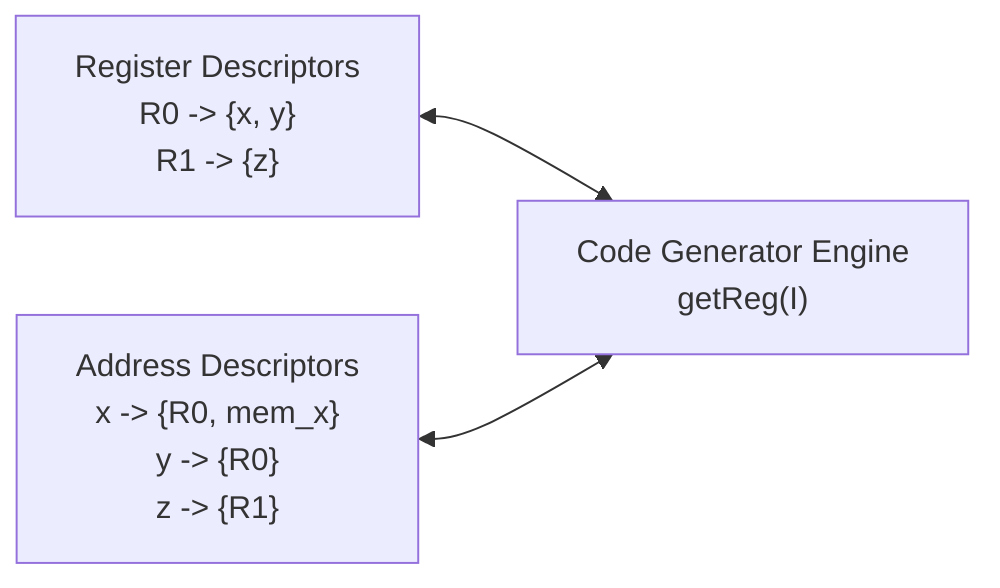

# A Simple Code Generator Algorithm

## The Problem and Earlier Tools

The Dragon Book defines a classic, robust code generation algorithm that translates a basic block of Three-Address Code into machine instructions statement-by-statement. 

To track where values are currently located without redundant loads and stores, the algorithm maintains two dynamic tracking structures:
1. **Register Descriptors:** For each physical register $R$, tracks the set of variable names whose current values are currently held in $R$.
2. **Address Descriptors:** For each variable name $x$, tracks the set of memory locations (registers, stack slots, memory addresses) where the current value of $x$ can currently be found.



---

## Developing the Core Idea

The core challenge in code generation is minimizing memory traffic (expensive `LD` and `ST` instructions) while working within a fixed pool of hardware registers. The simple code generator solves this by:
1. Keeping values in registers as long as possible.
2. Exploiting **liveness and next-use information** to reuse physical registers the instant their current variable is no longer needed.
3. Implementing **zero-cost copy statements** ($x = y$) by aliasing variable names inside the same register descriptor rather than emitting redundant register-to-register moves.

### The Register Allocation Function: `getReg(I)`

For a three-address instruction $I: x = y + z$ (or $x = y \text{ op } z$):

1. **Selecting Register for Operand $y$ ($R_y$):**
   - If $y$ is already in a register, use that register as $R_y$.
   - Else, if an unallocated (empty) register exists, pick it.
   - Else (all registers full), pick an occupied register $R$ to **spill**:
     - Score each register $R$ by counting the number of store instructions needed to evacuate variables currently held in $R$. (If a variable in $R$ already exists in memory, no store is needed!).
     - Select the register with the lowest spill score, emit $\text{ST } v, R$ for any variable $v$ not already in memory, update descriptors, and assign $R$ as $R_y$.

2. **Selecting Register for Operand $z$ ($R_z$):**
   - Evaluated identically to $y$.

3. **Selecting Destination Register for Result $x$ ($R_x$):**
   - If $y$ has **no next use** after instruction $I$ and $R_y$ holds *only* $y$, allocate $R_y$ as $R_x$! (Direct register reuse: $x$ overwrites $y$ in place).
   - Similarly, if $z$ has no next use and $R_z$ holds only $z$, $R_z$ can be chosen as $R_x$.
   - Else, if an empty register exists, pick it.
   - Else, choose a register holding only $x$, or pick a register to spill using the minimum-spill heuristic.
   - **Copy Statement Special Case ($x = y$):** Always choose $R_x = R_y$. No computation is emitted.

---

## Inputs

- Sequence of Three-Address Code (TAC) instructions within a single basic block.
- Precomputed **liveness and next-use annotations** for all variables at each TAC statement.
- Available hardware registers $\{R_1, R_2, \dots, R_k\}$.
- Initial Address Descriptors (variables initially reside in their named memory locations).

---

## Outputs

- Target assembly code (`LD`, `ST`, arithmetic/logic instructions).
- Final state of Register Descriptors and Address Descriptors.

---

## How It Works

### 1. Descriptor Management Rules

The code generator maintains consistency by applying four fundamental descriptor update rules:

- **Rule 1 (Load: `LD R, x`):**
  - Change register descriptor of $R$ so that it holds *only* $x$: $\text{reg\_desc}(R) = \{x\}$.
  - Add $R$ to the address descriptor of $x$: $\text{addr\_desc}(x) = \text{addr\_desc}(x) \cup \{R\}$.
  - Remove $R$ from the address descriptors of any variables previously in $R$.

- **Rule 2 (Store: `ST x, R`):**
  - Add memory location $x$ to the address descriptor of $x$: $\text{addr\_desc}(x) = \text{addr\_desc}(x) \cup \{x\}$.

- **Rule 3 (Operation: `OP Rx, Ry, Rz` for $x = y \text{ op } z$):**
  - Set register descriptor of $R_x$ to $\{x\}$.
  - Set address descriptor of $x$ to $\{R_x\}$ (its memory location is now **stale**, so memory location $x$ is removed from $\text{addr\_desc}(x)$!).
  - Remove $R_x$ from the address descriptors of any other variables that previously held $R_x$.

- **Rule 4 (Copy Statement: $x = y$):**
  - If $y$ is not already in a register $R_y$, emit `LD Ry, y`.
  - Add $x$ to the register descriptor of $R_y$: $\text{reg\_desc}(R_y) = \text{reg\_desc}(R_y) \cup \{x\}$.
  - Set address descriptor of $x$ to $\{R_y\}$.
  - *No assembly move instruction is generated!* $x$ and $y$ simply coexist in $R_y$.

### 2. End of Basic Block Actions

When the basic block finishes:
- Identify all user variables that are **live on exit** from the block.
- For each such variable $v$:
  - If $v$'s address descriptor does not contain its memory location $v$ (i.e., its latest computed value lives only in register $R$):
    - Emit:
      $$\text{ST } v, R$$
    - Add memory location $v$ to $\text{addr\_desc}(v)$.
- Compiler temporaries ($t_1, t_2, \dots$) whose lifetime is local to the block are **silently discarded** without generating stores.

---

## Pseudocode

```text
Algorithm: Simple_Code_Generator(B)
Input: Basic block B with liveness and next-use metadata; Registers R_1 .. R_k
Output: Emitted assembly instruction stream

1. Initialize Register Descriptors: reg_desc[R] = empty for all R
2. Initialize Address Descriptors: addr_desc[v] = {v} for all named variables v
3. For each TAC statement I in B (in forward order):
    Case 1: I is "x = y op z":
        (Rx, Ry, Rz) = getReg(I)
        If y not in Ry:
            Emit("LD " + Ry + ", " + choose_mem(y))
            Apply Rule 1 for LD Ry, y
        If z not in Rz:
            Emit("LD " + Rz + ", " + choose_mem(z))
            Apply Rule 1 for LD Rz, z
        Emit(op_code(op) + " " + Rx + ", " + Ry + ", " + Rz)
        Apply Rule 3 for OP Rx, Ry, Rz
        If y has no next use and Ry != Rx:
            reg_desc[Ry] = reg_desc[Ry] \ {y}
        If z has no next use and Rz != Rx:
            reg_desc[Rz] = reg_desc[Rz] \ {z}

    Case 2: I is "x = y":
        Ry = getReg(I)
        If y not in Ry:
            Emit("LD " + Ry + ", " + choose_mem(y))
            Apply Rule 1 for LD Ry, y
        Apply Rule 4 for Copy x = y

4. End of Block:
    For each variable v that is live on exit from B:
        If v not in addr_desc[v]:
            R = choose_register_from(addr_desc[v])
            Emit("ST " + v + ", " + R)
            addr_desc[v] = addr_desc[v] U {v}
```

---

## Example

### Problem Statement
Generate target assembly code for the following 5-statement basic block using **3 physical registers** ($R_1, R_2, R_3$). Variables $a, b, c, d$ initially reside in memory. Variables $a$ and $d$ are **live on exit**; compiler temporaries $t, u, v$ are dead on exit.

```text
(1) t = a - b
(2) u = a - c
(3) v = t + u
(4) a = d
(5) d = v + u
```

---

### Step-by-Step Simulation

#### Initial State (Prior to Execution)
- **Registers:** $R_1: \emptyset, \quad R_2: \emptyset, \quad R_3: \emptyset$
- **Address Descriptors:** $a: \{a\}, \; b: \{b\}, \; c: \{c\}, \; d: \{d\}, \; t: \emptyset, \; u: \emptyset, \; v: \emptyset$

---

#### Step 1: Instruction `t = a - b`
- **Register Selection `getReg(I)`:**
  - $a$ is loaded into empty register $R_1$.
  - $b$ is loaded into empty register $R_2$.
  - $b$ has no next use after this instruction $\implies R_2$ can be immediately reused as the destination register for $t$ ($R_t = R_2$).
- **Emitted Code:**
  ```assembly
  LD  R1, a
  LD  R2, b
  SUB R2, R1, R2
  ```
- **Descriptor State After Step 1:**
  - **Register Descriptors:** $R_1: \{a\}, \quad R_2: \{t\}, \quad R_3: \emptyset$
  - **Address Descriptors:** $a: \{a, R_1\}, \; b: \{b\}, \; c: \{c\}, \; d: \{d\}, \; t: \{R_2\}, \; u: \emptyset, \; v: \emptyset$

---

#### Step 2: Instruction `u = a - c`
- **Register Selection `getReg(I)`:**
  - $a$ is already in $R_1$ $\implies$ **no load needed for $a$!**
  - $c$ is loaded into empty register $R_3$.
  - Variable $a$ has no further use after instruction (2) $\implies R_1$ can be reused as the destination register for $u$ ($R_u = R_1$).
- **Emitted Code:**
  ```assembly
  LD  R3, c
  SUB R1, R1, R3
  ```
- **Descriptor State After Step 2:**
  - **Register Descriptors:** $R_1: \{u\}, \quad R_2: \{t\}, \quad R_3: \{c\}$
  - **Address Descriptors:** $a: \{a\}, \; b: \{b\}, \; c: \{c, R_3\}, \; d: \{d\}, \; t: \{R_2\}, \; u: \{R_1\}, \; v: \emptyset$
  *(Note: $R_1$ now holds $u$, so $R_1$ is removed from $a$'s address descriptor).*

---

#### Step 3: Instruction `v = t + u`
- **Register Selection `getReg(I)`:**
  - $t$ is already in $R_2$; $u$ is already in $R_1$.
  - Can we reuse $R_1$ or $R_2$ for $v$?
    - Variable $u$ has a next use at instruction (5) (`d = v + u`) $\implies R_1$ **cannot** be overwritten!
    - Variable $c$ in $R_3$ has no next use $\implies R_3$ is repurposed as the destination register for $v$ ($R_v = R_3$).
- **Emitted Code:**
  ```assembly
  ADD R3, R2, R1
  ```
- **Descriptor State After Step 3:**
  - **Register Descriptors:** $R_1: \{u\}, \quad R_2: \{t\}, \quad R_3: \{v\}$
  - **Address Descriptors:** $a: \{a\}, \; b: \{b\}, \; c: \{c\}, \; d: \{d\}, \; t: \{R_2\}, \; u: \{R_1\}, \; v: \{R_3\}$
  *(Note: $t$ has no next use after this line, making $R_2$ available for reuse in subsequent steps).*

---

#### Step 4: Instruction `a = d` (Copy Statement)
- **Register Selection `getReg(I)`:**
  - For a copy statement, $R_a = R_d$.
  - Variable $d$ currently resides only in memory. Since $t$ has no next use, $R_2$ is selected to load $d$.
  - By **Rule 4**, once $d$ is loaded into $R_2$, $a$ is simply added to $R_2$'s register descriptor. **No move instruction is emitted!**
- **Emitted Code:**
  ```assembly
  LD  R2, d
  ```
- **Descriptor State After Step 4:**
  - **Register Descriptors:** $R_1: \{u\}, \quad R_2: \{a, d\}, \quad R_3: \{v\}$
  - **Address Descriptors:** $a: \{R_2\}, \; b: \{b\}, \; c: \{c\}, \; d: \{d, R_2\}, \; t: \emptyset, \; u: \{R_1\}, \; v: \{R_3\}$
  *(Note: $a$'s value is now in $R_2$; memory location $a$ contains stale data and is removed).*

---

#### Step 5: Instruction `d = v + u`
- **Register Selection `getReg(I)`:**
  - $v$ is in $R_3$; $u$ is in $R_1$.
  - $u$ has no next use after instruction (5) $\implies R_1$ is reused as the destination register for $d$ ($R_d = R_1$).
- **Emitted Code:**
  ```assembly
  ADD R1, R3, R1
  ```
- **Descriptor State After Step 5:**
  - **Register Descriptors:** $R_1: \{d\}, \quad R_2: \{a\}, \quad R_3: \{v\}$
  - **Address Descriptors:** $a: \{R_2\}, \; b: \{b\}, \; c: \{c\}, \; d: \{R_1\}, \; t: \emptyset, \; u: \emptyset, \; v: \{R_3\}$
  *(Crucial: Because $d$ was redefined into $R_1$, $d$ is stripped from $R_2$. $R_2$ now exclusively holds $a$!).*

---

#### Step 6: End of Basic Block Flushing
- **Live Variables at Exit:** $a$ and $d$.
- **Location Check:**
  - Variable $a$ has address descriptor $\{R_2\}$ (memory is stale) $\implies$ emit `ST a, R2`.
  - Variable $d$ has address descriptor $\{R_1\}$ (memory is stale) $\implies$ emit `ST d, R1`.
  - Temporaries $u$ and $v$ are dead at exit $\implies$ discarded with zero stores.
- **Emitted Code:**
  ```assembly
  ST  a, R2
  ST  d, R1
  ```

---

### Complete Emitted Assembly Program

```assembly
LD  R1, a         ; Step 1: Load a
LD  R2, b         ; Step 1: Load b
SUB R2, R1, R2    ; Step 1: t = a - b (in R2)
LD  R3, c         ; Step 2: Load c
SUB R1, R1, R3    ; Step 2: u = a - c (in R1, reusing a's register)
ADD R3, R2, R1    ; Step 3: v = t + u (in R3, reusing c's register)
LD  R2, d         ; Step 4: Load d into R2; R2 now aliases {a, d} (zero-cost copy!)
ADD R1, R3, R1    ; Step 5: d = v + u (in R1, reusing u's register)
ST  a, R2         ; Exit: Flush live variable a to memory
ST  d, R1         ; Exit: Flush live variable d to memory
```

---

## Complexity

- **Time Complexity:** $O(N \cdot K)$ where $N$ is the number of TAC statements in the basic block and $K$ is the number of hardware registers (scanning register descriptors takes $O(K)$ time).
- **Space Complexity:** $O(V + K)$ storing descriptors for $V$ variables and $K$ registers.

---

## Properties

- **Termination:** Provably terminates on all well-formed compiler inputs.
- **Correctness:** Preserves the underlying language semantics and program data dependencies.

---

## Limitations

- Greedy, local decision making; does not optimize across basic block boundaries.
- Can emit redundant stores if variable liveness is computed conservatively.

---

## Common Mistakes

- Forgetting to update liveness information or next-use pointers.
- Misinterpreting index bounds during stack or interval scans.

---

## Exam Relevance

Frequently tested on final examinations via hand-simulation of A Simple Code Generator Algorithm on given code fragments or graphs.

---

## Related Concepts

- [[Basic Blocks and Control Flow Graphs]]
- [[Liveness and Next-Use Analysis within Basic Blocks]]
- [[Peephole Optimization Techniques]]

---

## Prerequisites

- [[Liveness and Next-Use Analysis within Basic Blocks]]

---

## Problems

- [[Problem — Basic Block Partitioning and Next-Use Table]]

---

## Sources

- **Lecture Slides:** [[cse309/01 - Sources/Lectures/KMS Merged.pdf|KMS Merged.pdf]], Chapter 8 (Slides 348–358).
- **Textbook:** Aho, Lam, Sethi, Ullman, *Compilers: Principles, Techniques, & Tools* (2nd Ed.), Section 8.6.

---

## Navigation

> 📖 **Reading Order:** Step 58 of 76 | **Module 4: Code Generation**  
> ◄ **Previous:** [[DAG Construction and Local Optimization of Basic Blocks]] | ► **Next:** [[Peephole Optimization Techniques]]
