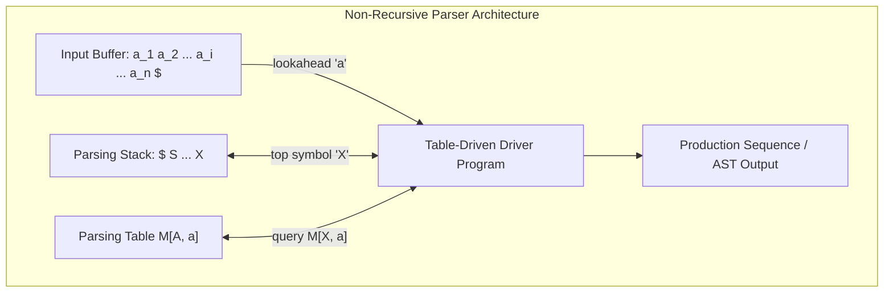

# LL(1) Parsing Table Construction and Execution Algorithm

## Starting Point and the Problem

In [[Top-Down and Predictive Parsing]], we established that a predictive parser chooses production rules deterministically using one token of lookahead without backtracking. 

To execute this efficiently in code, compilers replace recursive procedure calls with a **Table-Driven Predictive Parsing Architecture**. This requires two concrete algorithms:
1. **The Table Construction Algorithm:** A compiler-generation algorithm that takes the $\text{FIRST}$ and $\text{FOLLOW}$ sets of a grammar and compiles them into a two-dimensional lookup table $M[A, a]$.
2. **The Table-Driven Driver Algorithm:** A fast, non-recursive runtime loop that manipulates an explicit parsing stack and the input buffer using table $M$.

---

## Part 1: Construction of the LL(1) Parsing Table

### Input and Output
- **Input:** Context-Free Grammar $G = (V, \Sigma, R, S)$ and its precomputed $\text{FIRST}$ and $\text{FOLLOW}$ sets.
- **Output:** Parsing table $M[A, a]$, where rows are nonterminals $A \in V$, and columns are terminals $a \in \Sigma \cup \{\$\}$.

### Formal Algorithm
```text
Algorithm Construct_LL1_Parsing_Table:
1. Initialize all entries of table M[A, a] to empty (error).
2. For each production rule A -> alpha in grammar G:
       a. For each terminal 'a' in FIRST(alpha):
              Add A -> alpha to M[A, a].
              
       b. If epsilon is in FIRST(alpha):
              For each terminal 'b' in FOLLOW(A) (including '$' if $ in FOLLOW(A)):
                  Add A -> alpha to M[A, b].

3. For each nonterminal A and terminal b in FOLLOW(A):
       If M[A, b] is still empty, mark M[A, b] = "synch" (for error recovery).
```

### The LL(1) Test: Conflict Detection
- If the above algorithm attempts to place **two or more distinct productions** into the exact same cell $M[A, a]$, then the grammar is **NOT LL(1)**!
- Such a cell collision is called an **LL(1) Parsing Conflict**.
- If every cell in table $M$ contains at most one production, the grammar is formally verified to be **LL(1)**.

---

## Part 2: Non-Recursive Table-Driven LL(1) Parser Engine

### The Parsing Architecture



### Data Structures
1. **Input Buffer:** Contains the sequence of terminal tokens followed by endmarker `$`. A pointer points to the current lookahead token $a$.
2. **Parsing Stack:** Stores grammar symbols from $(V \cup \Sigma \cup \{\$\})$. 
   - Initialized with bottom marker `$` and start symbol $S$ on top: `[$, S]`.
3. **Table $M[A, a]$:** Dictates which production to expand when nonterminal $A$ faces lookahead terminal $a$.

---

## The Driver Algorithm: Pseudocode

```text
Algorithm Non_Recursive_LL1_Parser:
Initialize stack = [$, S]
Set 'a' to the first token in the input buffer

loop:
    Let X be the symbol currently on top of the stack.
    
    // Case 1: Stack top is endmarker
    if X == '$':
        if a == '$':
            return SUCCESS // Entire input legally accepted!
        else:
            report_syntax_error("Unexpected characters after end of expression")
            return FAILURE

    // Case 2: Stack top is a terminal symbol
    else if X in Sigma:
        if X == a:
            pop X from the stack
            advance input buffer to the next token 'a'
        else:
            report_syntax_error("Expected terminal " + X + ", found " + a)
            // Error recovery: pop X from stack or skip input symbol 'a'
            
    // Case 3: Stack top is a nonterminal symbol
    else if X in V:
        if M[X, a] == (X -> Y_1 Y_2 ... Y_k):
            pop X from the stack
            // Push production body symbols in REVERSE order
            // so Y_1 ends up on top of the stack!
            if (Y_1 Y_2 ... Y_k != epsilon):
                push Y_k, Y_{k-1}, ..., Y_1 onto stack
                
            emit_production(X -> Y_1 Y_2 ... Y_k)
            
        else if M[X, a] == "synch":
            report_syntax_error("Syntax error on token " + a)
            pop X from the stack // Panic-mode recovery: skip nonterminal X!
            
        else:
            report_syntax_error("Illegal syntax on token " + a)
            advance input buffer // Panic-mode recovery: skip bad token 'a'!
```

---

## Why Reverse Push Order is Critical

When expanding production $X \to Y_1 Y_2 \dots Y_k$:
- We must process the sub-phrase corresponding to $Y_1$ *first*, followed by $Y_2$, through $Y_k$.
- Because a stack is a **Last-In, First-Out (LIFO)** data structure, pushing symbols in forward order ($Y_1, \dots, Y_k$) would leave $Y_k$ on top!
- Therefore, the algorithm pops $X$ and pushes symbols in **reverse order**:
  1. Push $Y_k$
  2. Push $Y_{k-1}$
  3. $\dots$
  4. Push $Y_1$
- This guarantees that $Y_1$ is at the very top of the stack, ready to be expanded or matched immediately.

---

## Complexity Analysis

- **Time Complexity:** $O(n)$ where $n$ is the number of tokens in the input string.
  - In each step of the loop, the parser either:
    - Pops a terminal and consumes an input token ($n$ times maximum).
    - Expands a nonterminal. In a grammar with no cycles or useless symbols, the number of nonterminal expansions is linearly proportional to the size of the parse tree ($O(n)$ steps).
- **Space Complexity:** $O(|V| \times |\Sigma|)$ for table $M$, plus $O(d)$ for the stack, where $d$ is the maximum derivation tree depth (bounded by $n$).

---

## Common Mistakes

- **Pushing Symbols in Forward Order:** Pushing $Y_1, Y_2$ onto stack. The stack top becomes $Y_2$, inverting the left-to-right grammatical order!
- **Confusing Terminal Match with Nonterminal Expansion:** Trying to advance the input pointer when expanding a nonterminal. You **never advance the input pointer** on nonterminal expansion ($M[X, a]$)! You *only* advance the input pointer when a terminal on top of the stack directly matches the current lookahead token ($X == a$).

---

## Exam Relevance

In BUET CSE 309 examinations:
1. Constructing the complete $M[A, a]$ parsing table from scratch.
2. Tracing the 3-column table (`Stack`, `Input`, `Action Taken`) for an input string step-by-step.
3. Identifying parsing table collisions and explaining why a grammar is not LL(1).

---

## Related Concepts

- [[Context-Free Grammars and Syntax Analysis]]
- [[FIRST and FOLLOW Sets Formulas]]
- [[Top-Down and Predictive Parsing]]
- [[LL(1) Parser Construction and Simulation Example]]

---

## Prerequisites

- [[FIRST and FOLLOW Sets Formulas]]
- [[Top-Down and Predictive Parsing]]

---

## Problems

- [[Problem — LL(1) Grammar Verification and Parsing Table Construction]]

---

## Sources

- **Lecture Slides:** [[cse309/01 - Sources/Lectures/Rumi Sir Merged.pdf|Rumi Sir Merged.pdf]], Chapter 4: Syntax Analysis (Slides 452–472).
- **Textbook:** Aho, Lam, Sethi, Ullman, *Compilers: Principles, Techniques, & Tools* (2nd Ed.), Section 4.4 (pp. 222–228).

---

## Navigation

> 📖 **Reading Order:** Step 13 of 76 | **Module 3: Syntax Analysis & Top-Down Parsing**  
> ◄ **Previous:** [[Top-Down and Predictive Parsing]] | ► **Next:** [[LL(1) Parser Construction and Simulation Example]]
