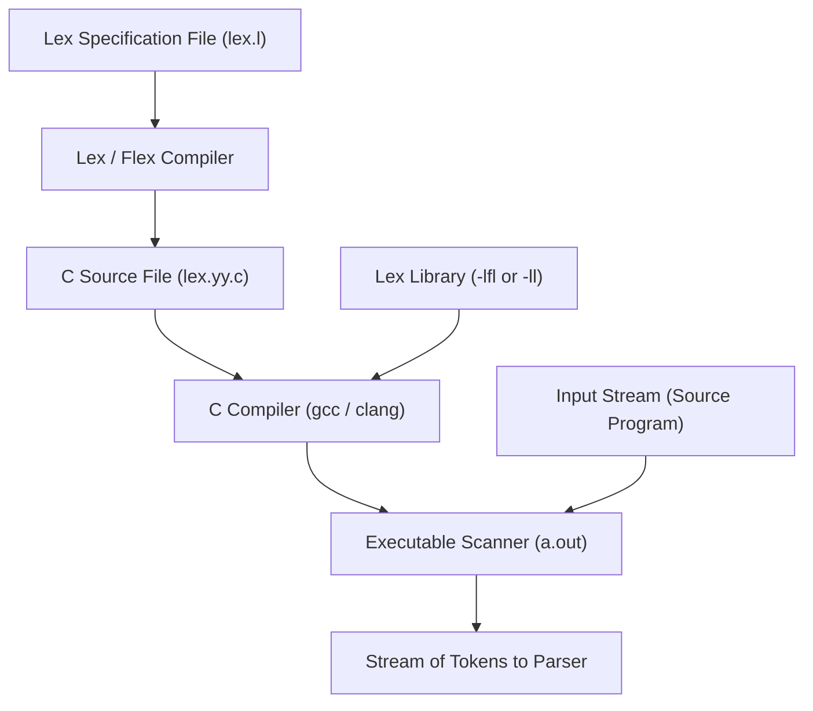
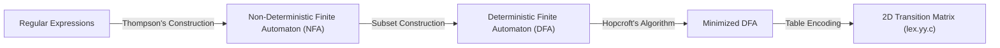

# Lexical Analyzer Generation with Lex

## Starting Point and the Problem

Drawing transition diagrams and writing custom C/C++ `switch-case` scanners by hand is tedious, error-prone, and difficult to maintain when a language grammar evolves. If a programmer adds a new operator or modifies the syntax for numeric constants, dozens of interrelated states and retraction conditions must be manually adjusted in code.

In 1975, Mike Lesk and Eric Schmidt at Bell Labs developed **Lex** (and its modern GNU counterpart, **Flex**)—a compiler-construction tool that takes a high-level declarative specification of regular expressions and automatically generates a complete, highly optimized C scanner program.

---

## Developing the Core Idea: The Lex Build Architecture

The workflow for creating a lexical analyzer using Lex involves three distinct compilation stages:



1. **Step 1:** The developer writes token patterns and semantic actions in a file named `lex.l`.
2. **Step 2:** The Lex compiler translates `lex.l` into a standard C source file, conventionally named `lex.yy.c`. Inside `lex.yy.c`, Lex constructs a state machine table and a driver function called `yylex()`.
3. **Step 3:** The C compiler compiles `lex.yy.c` (linking with the Lex runtime library `-lfl`), producing an executable program. When invoked, `yylex()` reads characters from `stdin` and executes user actions when patterns match.

---

## Structure of a Lex Program

A Lex specification file consists of three sections separated by `%%` delimiters:

```lex
declarations
%%
translation rules
%%
auxiliary functions
```

### 1. Declarations Section
Contains two kinds of definitions:
- **C Code Enclosure (`%{ ... %}`):** Direct C preprocessor directives, header files (`#include <stdio.h>`), external variable declarations, and token constants (shared with the parser). Lex copies this block verbatim to the top of `lex.yy.c`.
- **Regular Definitions:** Named macro definitions that simplify complex regular expressions:
  ```lex
  %{
  #include <stdio.h>
  #define LT 1
  #define LE 2
  #define ID 3
  %}

  delim     [ \t\n]
  ws        {delim}+
  letter    [A-Za-z]
  digit     [0-9]
  id        {letter}({letter}|{digit})*
  ```

### 2. Translation Rules Section
Specifies the patterns and the C code actions executed upon a match:
```lex
pattern   { C code action }
```
When `yylex()` matches a prefix of the input corresponding to `pattern`, it sets two global variables:
- `yytext`: A null-terminated char pointer pointing to the current lexeme in the input buffer.
- `yyleng`: An integer holding the length of the matched lexeme.
It then executes the enclosed C code:
```lex
%%
{ws}            { /* Skip whitespace; no token returned */ }
"if"            { return IF; }
"then"          { return THEN; }
"<="            { return LE; }
"<"             { return LT; }
{id}            { yylval = (int)installID(); return ID; }
.               { printf("Lexical Error: unrecognized char %s\n", yytext); }
%%
```

### 3. Auxiliary Functions Section
Contains supporting C helper functions (e.g., symbol table insertion functions, error handlers, or a custom `main()` function if running standalone):
```lex
int installID() {
    // Inserts yytext into symbol table if not already present
    // Returns pointer/index to symbol table entry
}

int yywrap() {
    return 1; // Terminates scanner upon encountering EOF
}
```

---

## Conflict Resolution Rules in Lex

In any non-trivial programming language, regular expressions will overlap. Consider the input string `if` or `else123`:
- Does `if` match the keyword `if` or the identifier pattern `letter(letter|digit)*`?
- Does `then_var` match the keyword `then` followed by `_var`, or is it a single identifier?

Lex resolves all pattern conflicts deterministically using two fundamental rules:

### Rule 1: Longest Match (Maximal Munch)
*Lex always prefers the pattern that matches the longest prefix of the remaining input.*
- If the input is `then_counter`:
  - Pattern `"then"` matches the first 4 characters (`then`).
  - Pattern `{id}` matches all 12 characters (`then_counter`).
  - By the **Longest Match rule**, Lex selects `{id}` and does not trigger the keyword rule.

### Rule 2: Rule Priority (First Rule Match)
*If two or more patterns match the exact same longest prefix, Lex selects the rule that appears earliest in the specification file.*
- If the input is `if`:
  - Pattern `"if"` matches 2 characters.
  - Pattern `{id}` also matches 2 characters.
  - Because `"if"` is written above `{id}` in the rules section, Lex chooses `"if"`!
- **Crucial Rule:** Keywords must *always* be placed above the generic identifier pattern `{id}` in a Lex file!

---

## The Underlying Theoretical Pipeline: From Regex to Machine Code

How does Lex convert regular expressions into lightning-fast code? It implements a 4-step formal automata pipeline:



1. **Thompson's Construction (RE $\to$ NFA):**
   - Synthesizes a unified NFA combining all patterns in parallel with $\epsilon$-transitions from a single start state to individual pattern NFAs.
   - Preserves rule priority by tagging each accepting state with its rule number.
2. **Subset Construction (NFA $\to$ DFA):**
   - Eliminates non-determinism and $\epsilon$-transitions by computing $\epsilon\text{-closure}$ and state sets. Each DFA state represents a set of simultaneous NFA states.
3. **DFA Minimization (Hopcroft's Algorithm):**
   - Partitions states into equivalence classes, merging redundant states to minimize table size.
4. **Table Compression and Driver:**
   - Emits a compact 2D transition array `next_state = transition[current_state][input_char]` and a standard execution driver loop in `lex.yy.c`.

---

## Execution Mechanics of `yylex()`

When called by the parser:
1. `yylex()` begins in state $0$ with `lexemeBegin = forward`.
2. It reads characters from the input buffer, advancing through DFA states.
3. If it reaches an accepting state, it records the state and the current `forward` position as the "last seen match".
4. It continues reading until no valid transition exists in the DFA.
5. It then **retracts** `forward` back to the last seen match, assigns `yytext` and `yyleng`, executes the corresponding C action, and returns.
6. If the action executes a `return` statement, control returns to the parser. If the action does not return (e.g., whitespace), the loop restarts automatically for the next token.

---

## Important Properties and Complexity

- **Time Complexity:** $O(n)$ where $n$ is the number of characters in the input file. In a DFA, each character is examined at most a constant number of times (including lookahead rollbacks).
- **Space Complexity:** $O(|\text{DFA states}| \times |\Sigma|)$ for the transition matrix. Lex uses row-compression techniques to reduce sparse matrix footprints.

---

## Common Mistakes

- **Reversing Rule Order for Keywords and Identifiers:** Placing `{id}` above `"while"`. Because `{id}` matches `while` with the same length, the first-rule priority causes `while` to be returned as an identifier, crashing the parser!
- **Overlooking Unmatched Characters:** Forgetting a fallback rule `.` at the end of the rules section. In Lex, characters not matched by any rule are echoed directly to `stdout` by default, which can silently corrupt terminal output.

---

## Exam Relevance

In BUET CSE 309 examinations:
1. Tracing how Lex resolves ambiguous inputs using the Longest Match and First Rule Match rules.
2. Explaining the three sections of a `.l` file and the roles of `yytext`, `yyleng`, and `yylex()`.
3. Diagramming the RE $\to$ NFA $\to$ DFA compilation pipeline that Lex uses internally.

---

## Related Concepts

- [[Lexical Analysis Fundamentals]]
- [[Specification and Recognition of Tokens]]
- [[Token Recognition and Lex Specification Example]]
- [[Context-Free Grammars and Syntax Analysis]]

---

## Prerequisites

- [[Specification and Recognition of Tokens]]

---

## Problems

- [[Problem — Lexical Token Recognition and Buffer Simulation]]

---

## Sources

- **Lecture Slides:** [[cse309/01 - Sources/Lectures/Rumi Sir Merged.pdf|Rumi Sir Merged.pdf]], Chapter 3: Lexical Analysis (Slides 245–282).
- **Textbook:** Aho, Lam, Sethi, Ullman, *Compilers: Principles, Techniques, & Tools* (2nd Ed.), Section 3.5 (pp. 140–151).

---

## Navigation

> 📖 **Reading Order:** Step 06 of 76 | **Module 2: Lexical Analysis**  
> ◄ **Previous:** [[Specification and Recognition of Tokens]] | ► **Next:** [[Token Recognition and Lex Specification Example]]
