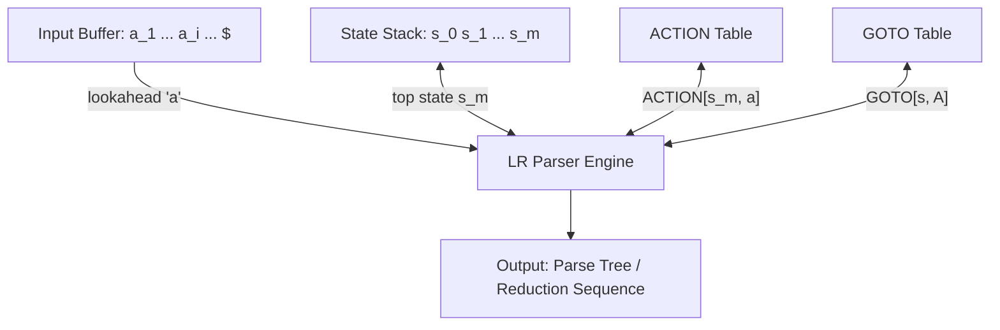

# SLR(1) Parsing Table Construction and LR Parser Algorithm

## Starting Point and the Problem

In [[LR(0) Items and the LR(0) Automaton]], we built the LR(0) automaton—a deterministic finite automaton whose states are sets of LR(0) items. However, an LR(0) state machine alone does not know when to reduce. In a pure LR(0) parser, if an item set contains a complete item $[A \to \alpha \cdot]$, the parser would be forced to reduce *regardless of what the next input token is*! This creates conflicts whenever a state contains both a shift item and a reduce item, or multiple reduce items.

To resolve these conflicts using 1 token of lookahead without blowing up the number of states, computer scientists introduced **Simple LR (SLR(1))**. The key insight of SLR(1) is:
*A reduction $A \to \alpha$ should only be executed on lookahead token $a$ if $a$ can legally follow $A$ in some valid sentence—that is, if and only if $a \in \text{FOLLOW}(A)$!*

---

## Developing the Core Idea: The SLR(1) Table Construction Algorithm

### Input and Output
- **Input:** Augmented Grammar $G'$ and its precomputed $\text{FOLLOW}$ sets for all nonterminals.
- **Output:** The SLR(1) parsing table consisting of two components:
  1. $\text{ACTION}[i, a]$: Dictates parser actions for state $i$ and terminal $a \in \Sigma \cup \{\$\}$.
  2. $\text{GOTO}[i, A]$: Dictates state transitions for state $i$ and nonterminal $A \in V$.

---

### The Formal SLR(1) Construction Algorithm

```text
Algorithm Construct_SLR1_Parsing_Table:
1. Construct the canonical collection of sets of LR(0) items:
   C = { I_0, I_1, ..., I_n }

2. State i is constructed from item set I_i. The entries for state i are determined as follows:

   a. Shift Action:
      If [A -> alpha . a beta] is in I_i, and GOTO(I_i, a) = I_j:
          Set ACTION[i, a] = "shift j" (abbreviated s_j).
          (Here, 'a' must be a terminal).

   b. Reduce Action:
      If [A -> alpha .] is in I_i, where A != S':
          For all terminals 'a' in FOLLOW(A):
              Set ACTION[i, a] = "reduce A -> alpha" (abbreviated r_k, where k is production number).

   c. Accept Action:
      If [S' -> S .] is in I_i:
          Set ACTION[i, $] = "accept".

3. GOTO Function for Nonterminals:
   For all nonterminals A:
       If GOTO(I_i, A) = I_j:
           Set GOTO[i, A] = j.

4. All remaining blank entries in ACTION and GOTO are set to "error".
```

---

## Definition of an SLR(1) Grammar

A grammar is **SLR(1)** (Simple LR with 1 lookahead) if and only if the parsing table constructed by the algorithm above has **no multiply-defined entries (no collisions)**.
- If any cell $\text{ACTION}[i, a]$ attempts to hold both a shift and a reduce action $\implies$ **Shift/Reduce Conflict**.
- If any cell $\text{ACTION}[i, a]$ attempts to hold two different reduce actions $\implies$ **Reduce/Reduce Conflict**.
- If no conflicts exist anywhere in the table, the grammar is verified to be **SLR(1)**.

---

## The LR Parsing Driver Algorithm

### Architecture and Data Structures
An LR parser operates with:
1. **Input Buffer:** Holds terminal tokens followed by endmarker `$`. A pointer points to the current lookahead token $a$.
2. **Stack:** Holds a sequence of alternating states and grammar symbols:
   $$s_0 \; X_1 \; s_1 \; X_2 \; s_2 \; \dots \; X_m \; s_m$$
   In production implementations, because each state $s_i$ uniquely encodes the symbol $X_i$ that transitioned into it, **the stack needs to store only the sequence of state numbers**:
   $$s_0 \; s_1 \; s_2 \; \dots \; s_m$$
   where $s_0$ is the initial start state ($I_0$), and $s_m$ is on top of the stack.



---

### The LR Execution Algorithm: Pseudocode

```text
Algorithm LR_Parser_Execution:
Initialize stack = [s_0]
Set 'a' to the first token in the input buffer

loop:
    Let s = top state on the stack
    
    // Consult the ACTION table
    if ACTION[s, a] == "shift j":
        push state 'j' onto the stack
        advance input buffer to the next token 'a'
        
    else if ACTION[s, a] == "reduce A -> beta":
        pop |beta| states from the stack
        Let s_prime be the new state now uncovered on top of the stack
        push GOTO[s_prime, A] onto the stack
        emit reduction rule A -> beta
        // Note: input pointer 'a' is NOT advanced on reduce!
        
    else if ACTION[s, a] == "accept":
        return SUCCESS // Parsing completed successfully!
        
    else: // ACTION[s, a] == "error"
        call syntax_error_recovery(s, a)
        return FAILURE
```

---

## Detailed Step Mechanics: How Shift and Reduce Work

### 1. Shift Mechanics ($s_j$)
- The parser reads lookahead terminal $a$.
- It matches an item $[A \to \alpha \cdot a \beta]$ in state $s$.
- It pushes the target state $j = \text{GOTO}(s, a)$ onto the stack and advances the input pointer.
- **Physical effect:** Terminal $a$ has now been shifted into the parser's active viable prefix.

### 2. Reduce Mechanics ($r_k$)
- The parser recognizes that handle $\beta$ is completely matched on top of the stack.
- Let $|\beta| = r$ be the number of symbols on the right-hand side of production $k$.
- The parser **pops $r$ states** from the stack.
- This uncovers state $s'$ (the state the parser was in *before* it started shifting the symbols of $\beta$!).
- The parser then queries $\text{GOTO}[s', A]$ and **pushes that new state onto the stack**.
- **Crucial Rule:** The input lookahead token $a$ is **NOT consumed**! It remains in the input buffer to be processed by the next parsing step.

---

## Limitations of SLR(1): Spurious Conflicts

While SLR(1) is significantly more powerful than LL(1), it has a well-known theoretical weakness:
- In Step 2b, whenever a complete item $[A \to \alpha \cdot]$ is present in state $i$, SLR(1) blindly places reduce actions in $\text{ACTION}[i, a]$ for **ALL** $a \in \text{FOLLOW}(A)$.
- However, $a \in \text{FOLLOW}(A)$ only means that $a$ can follow $A$ in *some* arbitrary derivation of the grammar; it does **not** mean that $a$ can legally follow $A$ in the *specific context of the current viable prefix*!
- This coarse approximation causes **spurious shift/reduce conflicts** in unambiguous grammars (e.g., assignment grammars with $S \to L = R$).
- **The Evolution to LR(1) and LALR(1):** To eliminate these spurious conflicts, **Canonical LR(1)** attaches specific lookahead tokens directly to each item ($[A \to \alpha \cdot \beta, \; a]$), and **LALR(1)** merges states with identical cores to keep table sizes identical to SLR(1) (the basis of **Yacc** and **Bison**).

---

## Important Properties and Complexity

- **Execution Time:** Strictly $O(n)$ linear time. Every shift consumes one input token ($n$ shifts total), and the number of reductions is bounded by the length of a derivation tree ($O(n)$ reductions).
- **Early Error Detection:** An LR parser will detect a syntax error at the earliest possible moment that an invalid token appears, never shifting an invalid token onto the stack.

---

## Common Mistakes

- **Popping the Wrong Number of States on Reduce:** Forgetting that production $A \to X_1 X_2 X_3$ has 3 symbols, requiring popping exactly 3 states from the stack. For an $\epsilon$-production ($A \to \epsilon$), $|\epsilon| = 0$, so **zero states are popped**!
- **Advancing the Input on Reduce:** Moving the input pointer during a reduction. Remember: `shift` consumes an input token; `reduce` strictly rearranges the stack!

---

## Exam Relevance

In BUET CSE 309 examinations:
1. Constructing the complete SLR(1) parsing table from the canonical collection of LR(0) items.
2. Tracing the state stack, input buffer, and actions of the LR parser step-by-step.
3. Identifying SLR(1) shift/reduce conflicts and proving why a grammar fails to be SLR(1).

---

## Related Concepts

- [[Bottom-Up Parsing, Reductions, and Handles]]
- [[Shift-Reduce Parsing and Parsing Conflicts]]
- [[LR(0) Items and the LR(0) Automaton]]
- [[SLR(1) Automaton and Parsing Table Construction Example]]
- [[Problem — SLR(1) Table Construction and Conflict Analysis]]

---

## Prerequisites

- [[LR(0) Items and the LR(0) Automaton]]
- [[FIRST and FOLLOW Sets Formulas]]

---

## Problems

- [[Problem — SLR(1) Table Construction and Conflict Analysis]]

---

## Sources

- **Lecture Slides:** [[cse309/01 - Sources/Lectures/Rumi Sir Merged.pdf|Rumi Sir Merged.pdf]], Chapter 4: Syntax Analysis (Slides 647–704).
- **Textbook:** Aho, Lam, Sethi, Ullman, *Compilers: Principles, Techniques, & Tools* (2nd Ed.), Section 4.5.3, 4.6 (pp. 246–259).

---

## Navigation

> 📖 **Reading Order:** Step 19 of 76 | **Module 4: Bottom-Up Parsing & LR Parsers**  
> ◄ **Previous:** [[LR(0) Items and the LR(0) Automaton]] | ► **Next:** [[SLR(1) Automaton and Parsing Table Construction Example]]
