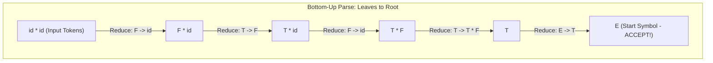

# Bottom-Up Parsing, Reductions, and Handles

## Starting Point and the Problem

In top-down parsing, the parser starts at the start symbol $S$ and predicts expansions downward toward the input tokens. While intuitive, top-down parsers have severe limitations: they cannot handle left recursion without extensive grammar rewriting, they fail on common programming language idioms, and they require grammar restrictions like LL(1).

**Bottom-Up Parsing** approaches the problem from the opposite direction. It starts directly with the terminal tokens given by the lexical analyzer at the leaves of the tree and works **upward toward the root $S$**. By building the parse tree from the bottom up, bottom-up parsers can handle left-recursive grammars naturally, support a far wider class of grammars (including almost all programming language constructs), and detect syntax errors at the earliest possible left-to-right moment.

---

## Developing the Core Idea: Reductions

The fundamental operation of bottom-up parsing is the **Reduction**.

In a derivation step:
$$A \Rightarrow \beta$$
we replace nonterminal $A$ with production body $\beta$. 

In a **reduction**, we reverse this operation:
We inspect the current sequence of symbols, locate a substring $\beta$ that matches the right-hand side of some production rule $A \to \beta$, and **replace $\beta$ with $A$**!

The goal of bottom-up parsing is to construct a sequence of reductions that transforms the initial string of input tokens into the grammar's start symbol $S$.

---

## Fundamental Equivalence Theorem: Rightmost Derivation in Reverse

What is the formal mathematical relationship between bottom-up reductions and formal derivations?

### Theorem
*A bottom-up parse corresponds exactly to constructing a **Rightmost Derivation in Reverse** (the reverse of a canonical derivation).*

### Proof Intuition and Demonstration
Consider the unambiguous expression grammar:
$$\begin{aligned}
(1)\; E &\to E + T \\
(2)\; E &\to T \\
(3)\; T &\to T * F \\
(4)\; T &\to F \\
(5)\; F &\to (E) \mid \mathbf{id}
\end{aligned}$$
Consider the rightmost derivation of $\mathbf{id} * \mathbf{id}$:
$$E \Rightarrow_{rm} T \Rightarrow_{rm} T * F \Rightarrow_{rm} T * \mathbf{id} \Rightarrow_{rm} F * \mathbf{id} \Rightarrow_{rm} \mathbf{id} * \mathbf{id}$$

Now read this derivation backwards from the rightmost sentence $\mathbf{id} * \mathbf{id}$ to $E$:
1. $\mathbf{id} * \mathbf{id}$ $\implies$ Reduce first $\mathbf{id}$ via $F \to \mathbf{id} \implies F * \mathbf{id}$
2. $F * \mathbf{id}$ $\implies$ Reduce $F$ via $T \to F \implies T * \mathbf{id}$
3. $T * \mathbf{id}$ $\implies$ Reduce second $\mathbf{id}$ via $F \to \mathbf{id} \implies T * F$
4. $T * F$ $\implies$ Reduce $T * F$ via $T \to T * F \implies T$
5. $T$ $\implies$ Reduce $T$ via $E \to T \implies E$

Each reduction step in bottom-up parsing is precisely the inverse of a step in a canonical rightmost derivation!

---

## Handles and Handle Pruning

In any intermediate sentential form, there may be multiple substrings that happen to match the right-hand side of *some* production rule. If the parser reduces the wrong substring, it enters a blind alley from which it can never reach the start symbol $S$.

To parse correctly, the parser must locate the **Handle**.

### Formal Definition of a Handle
A **handle** of a right-sentential form $\gamma$ is a production rule $A \to \beta$ and a position within $\gamma$ where the string $\beta$ may be replaced by $A$ to yield the previous right-sentential form in a rightmost derivation:
$$S \Rightarrow_{rm}^* \alpha A w \Rightarrow_{rm} \alpha \beta w = \gamma$$
where $w$ is a string consisting **entirely of terminal symbols** ($w \in \Sigma^*$).

### The Unambiguous Grammar Guarantee
- If a grammar $G$ is **unambiguous**, every right-sentential form has **exactly one unique handle**.
- In an unambiguous grammar, there is never any doubt about what to reduce or where to reduce it—if the parser can find the handle!

### Handle Pruning
The process of bottom-up parsing is formally called **Handle Pruning**:
1. Start with the input terminal string $w$.
2. Identify the handle $A_1 \to \beta_1$ in $w$.
3. Replace $\beta_1$ with $A_1$ to obtain the preceding right-sentential form $\gamma_1$.
4. Identify the handle $A_2 \to \beta_2$ in $\gamma_1$.
5. Replace $\beta_2$ with $A_2$ to obtain $\gamma_2$.
6. Repeat until the right-sentential form is the start symbol $S$.

---

## The Central Engineering Challenge

How can a bottom-up parser efficiently find the handle without scanning the entire sentential form over and over again?

### The Shift-Reduce Invariant
Notice the right-sentential form structure:
$$\gamma = \alpha \beta w$$
Because $w$ consists exclusively of terminals, **the handle $\beta$ always appears immediately to the left of the unread terminal string $w$**!
The handle *never* occurs inside $w$, and no reduction is ever needed to the right of the handle.

This invariant means:
- All symbols to the left of the handle ($\alpha$) and the handle itself ($\beta$) can be stored on a **Stack**.
- The unread terminal string ($w$) sits in the **Input Buffer**.
- The handle always appears at the **very top of the stack**!
- Finding the handle and pruning it reduces to stack operations: shifting terminals onto the stack until the handle appears on top, then popping the handle and pushing its nonterminal head. This architecture is known as **Shift-Reduce Parsing**.

---

## Important Properties and Guarantees

- **No Premature Reductions:** A substring matching a production body is a handle *only* if reducing it allows the derivation to trace back to $S$. If a reduction yields a string from which $S$ cannot be reached, that substring was NOT a handle.
- **Viable Prefix Property:** The prefixes of right-sentential forms that can appear on the stack of a shift-reduce parser are called **viable prefixes**. Viable prefixes can always be recognized by a Finite Automaton (the LR(0) automaton).

---

## Common Mistakes

- **Assuming Any Substring Match is a Handle:** Seeing a substring that matches $A \to \beta$ and immediately reducing it. If $E \to T$ and $T \to F$, reducing $T$ prematurely when the input is $T * F$ destroys the handle $T * F$!
- **Confusing Leftmost with Rightmost Derivations:** Thinking bottom-up parsing reverses a leftmost derivation. Bottom-up parsing strictly reverses a **rightmost derivation** (because terminals are consumed from left to right, leaving the rightmost nonterminal to be reduced first).

---

## Exam Relevance

In BUET CSE 309 examinations:
1. Defining the formal concept of a **Handle** and explaining **Handle Pruning**.
2. Demonstrating that a given bottom-up parse sequence is the reverse of a rightmost derivation.
3. Identifying handles in each intermediate sentential form for a given expression.

---

## Related Concepts

- [[Context-Free Grammars and Syntax Analysis]]
- [[Shift-Reduce Parsing and Parsing Conflicts]]
- [[LR(0) Items and the LR(0) Automaton]]
- [[SLR(1) Parsing Table Construction and LR Parser Algorithm]]

---

## Prerequisites

- [[Context-Free Grammars and Syntax Analysis]]

---

## Problems

- [[Problem — SLR(1) Table Construction and Conflict Analysis]]

---

## Sources

- **Lecture Slides:** [[cse309/01 - Sources/Lectures/Rumi Sir Merged.pdf|Rumi Sir Merged.pdf]], Chapter 4: Syntax Analysis (Slides 492–518).
- **Textbook:** Aho, Lam, Sethi, Ullman, *Compilers: Principles, Techniques, & Tools* (2nd Ed.), Section 4.5 (pp. 233–238).

---

## Navigation

> 📖 **Reading Order:** Step 16 of 76 | **Module 4: Bottom-Up Parsing & LR Parsers**  
> ◄ **Previous:** [[Problem — LL(1) Grammar Verification and Parsing Table Construction]] | ► **Next:** [[Shift-Reduce Parsing and Parsing Conflicts]]
