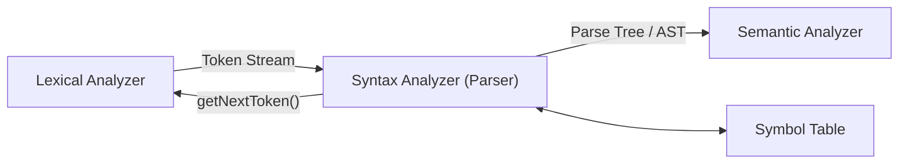
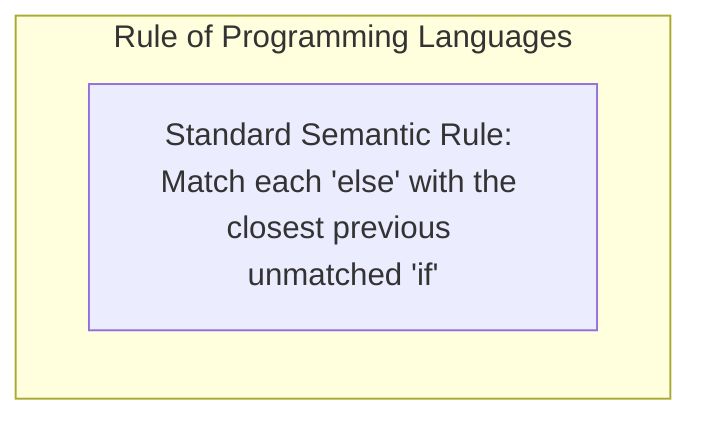

# Context-Free Grammars and Syntax Analysis

## Starting Point and the Problem

In the compiler pipeline, the lexical analyzer converts a flat character stream into a sequence of tokens:
$$\langle\mathbf{id}, \text{"total"}\rangle \quad \langle=\rangle \quad \langle\mathbf{id}, \text{"sum"}\rangle \quad \langle+\rangle \quad \langle\mathbf{number}, 42\rangle \quad \langle;\rangle$$
However, a token stream by itself contains no hierarchical structure. It does not verify whether parentheses are properly nested, whether operators bind to their correct operands according to precedence, or whether `if-else` branches are properly formed.

Regular expressions cannot verify nested structures because finite automata have finite memory and cannot count arbitrarily deep matching delimiters (such as $a^n b^n$). To model hierarchical nested structures, the **Syntax Analyzer (Parser)** relies on a more expressive mathematical formalism: **Context-Free Grammars (CFGs)**.

---

## Developing the Core Idea: The Parser's Role

The parser is the heart of the compiler front end:



The parser has three core duties:
1. **Verification:** Validates that the token stream satisfies the syntactic rules of the programming language.
2. **Structural Construction:** Builds a hierarchical intermediate tree (a **Parse Tree** or an **Abstract Syntax Tree (AST)**) representing grammatical relationships.
3. **Error Reporting and Recovery:** Detects syntax violations, emits informative diagnostics to the programmer, and recovers to continue checking the remainder of the file.

---

## Formal Definition of a Context-Free Grammar

A **Context-Free Grammar (CFG)** $G$ is formally defined as a 4-tuple:
$$G = (V, \Sigma, R, S)$$
where:
1. **$V$ (Nonterminals):** A finite set of syntactic variables representing sets of strings. Nonterminals impose a hierarchical structure on the language (e.g., $E, T, F, \text{stmt}$).
2. **$\Sigma$ (Terminals):** A finite set of basic symbols that form the actual strings of the language. In a compiler, terminals are the tokens returned by the lexical analyzer (e.g., $\mathbf{id}, +, *, (, ), \mathbf{if}$). Note that $V \cap \Sigma = \emptyset$.
3. **$S$ (Start Symbol):** A distinguished nonterminal ($S \in V$) that denotes the primary language construct (e.g., `program` or `expression`).
4. **$R$ (Production Rules):** A finite set of rewriting rules of the form:
   $$A \to \alpha$$
   where $A \in V$ is a single nonterminal (the head), and $\alpha \in (V \cup \Sigma)^*$ is a string of terminals and/or nonterminals (the body). If $\alpha = \epsilon$, the rule is called an **$\epsilon$-production** ($A \to \epsilon$), producing the empty string.

---

## Derivations and Sentential Forms

A derivation is the process of generating a terminal string by repeatedly replacing nonterminals with the bodies of their production rules, starting from $S$.

- **Single-Step Derivation ($\Rightarrow$):** If $A \to \gamma$ is a production, then $\alpha A \beta \Rightarrow \alpha \gamma \beta$.
- **Transitive Closure ($\Rightarrow^*$):** Indicates zero or more derivation steps.
- **Sentential Form:** A string $\alpha \in (V \cup \Sigma)^*$ such that $S \Rightarrow^* \alpha$. If $\alpha$ contains only terminals ($\alpha \in \Sigma^*$), it is called a **sentence** of the grammar.
- **Language Generated by Grammar:** $L(G) = \{w \in \Sigma^* \mid S \Rightarrow^* w\}$.

### 1. Leftmost Derivation ($\Rightarrow_{lm}$)
At every step, the **leftmost nonterminal** in the sentential form is chosen for replacement.
- Given grammar: $E \to E + E \mid E * E \mid \mathbf{id}$
- Leftmost derivation for $\mathbf{id} + \mathbf{id} * \mathbf{id}$:
  $$E \Rightarrow_{lm} E + E \Rightarrow_{lm} \mathbf{id} + E \Rightarrow_{lm} \mathbf{id} + E * E \Rightarrow_{lm} \mathbf{id} + \mathbf{id} * E \Rightarrow_{lm} \mathbf{id} + \mathbf{id} * \mathbf{id}$$

### 2. Rightmost Derivation ($\Rightarrow_{rm}$, Canonical Derivation)
At every step, the **rightmost nonterminal** in the sentential form is chosen for replacement.
- Rightmost derivation for the same string:
  $$E \Rightarrow_{rm} E + E \Rightarrow_{rm} E + E * E \Rightarrow_{rm} E + E * \mathbf{id} \Rightarrow_{rm} E + \mathbf{id} * \mathbf{id} \Rightarrow_{rm} \mathbf{id} + \mathbf{id} * \mathbf{id}$$

---

## Parse Trees versus Abstract Syntax Trees (AST)

A **Parse Tree** (Concrete Syntax Tree) is a graphical representation of a derivation:
- **Root:** Labeled by start symbol $S$.
- **Interior Nodes:** Labeled by nonterminals $A \in V$.
- **Children of Node $A$:** If $A \to X_1 X_2 \dots X_k$ is the production used, the children from left to right are labeled $X_1, X_2, \dots, X_k$.
- **Leaves:** Labeled by terminals, nonterminals, or $\epsilon$.
- **Yield of the Tree:** The string obtained by concatenating the leaves from left to right.

```
       Parse Tree (Concrete)                    Abstract Syntax Tree (AST)
              E                                             +
           /  |  \                                        /   \
          E   +   E                                     id     *
          |     / | \                                        /   \
         id    E  *  E                                      id   id
               |     |
              id    id
```

- **Parse Tree:** Captures every explicit grammar step, including intermediate nonterminals and punctuation parentheses.
- **Abstract Syntax Tree (AST):** Eliminates redundant intermediate nonterminals and parentheses; operators become interior nodes and operands become children. ASTs are used by semantic analysis and code generation.

---

## Ambiguity in Context-Free Grammars

A grammar that produces more than one parse tree for some sentence is said to be **ambiguous**.
Equivalently: A grammar is ambiguous if there exists at least one terminal string that possesses **two or more distinct leftmost derivations** (or two or more distinct rightmost derivations).

### Classic Example 1: Arithmetic Expression Ambiguity
Consider grammar $G_1$:
$$E \to E + E \mid E * E \mid (E) \mid \mathbf{id}$$
For the string $\mathbf{id} + \mathbf{id} * \mathbf{id}$, there are two distinct parse trees:

```
        Tree 1: Multiplies first (+)                Tree 2: Adds first (*)
                   E                                           E
                /  |  \                                     /  |  \
               E   +   E                                   E   *   E
               |     / | \                               / | \     |
              id    E  *  E                             E  +  E   id
                    |     |                             |     |
                   id    id                            id    id
```
- **Tree 1** evaluates as $\mathbf{id} + (\mathbf{id} * \mathbf{id})$ (standard mathematical operator precedence: $*$ over $+$).
- **Tree 2** evaluates as $(\mathbf{id} + \mathbf{id}) * \mathbf{id}$ (incorrect precedence).
Because both parse trees are syntactically valid under $G_1$, the grammar is ambiguous. A compiler cannot know which code to generate!

### Eliminating Expression Ambiguity: Precedence and Associativity
To resolve ambiguity, we rewrite the grammar into stratified levels:
1. A factor $F$ cannot be torn apart by any operator (highest precedence: parentheses, identifiers).
2. A term $T$ handles multiplication and division (next highest precedence).
3. An expression $E$ handles addition and subtraction (lowest precedence).
4. Left recursion enforces left-associativity.

**Unambiguous Expression Grammar:**
$$\begin{aligned}
E &\to E + T \mid T \\
T &\to T * F \mid F \\
F &\to (E) \mid \mathbf{id}
\end{aligned}$$
This grammar generates exactly *one* unique parse tree for $\mathbf{id} + \mathbf{id} * \mathbf{id}$, strictly forcing $*$ deeper in the tree than $+$.

---

### Classic Example 2: The Dangling-Else Ambiguity
Consider conditional statements in C, Java, or Pascal:
$$\text{stmt} \to \mathbf{if} \; \text{expr} \; \mathbf{then} \; \text{stmt} \mid \mathbf{if} \; \text{expr} \; \mathbf{then} \; \text{stmt} \; \mathbf{else} \; \text{stmt} \mid a$$
Now consider the compound statement:
$$\mathbf{if} \; E_1 \; \mathbf{then} \; \mathbf{if} \; E_2 \; \mathbf{then} \; S_1 \; \mathbf{else} \; S_2$$
Which $\mathbf{if}$ does the $\mathbf{else}$ belong to?
- **Interpretation 1:** The $\mathbf{else}$ matches the nearest preceding $\mathbf{if}$ ($E_2$).
- **Interpretation 2:** The $\mathbf{else}$ matches the outer $\mathbf{if}$ ($E_1$).



To eliminate ambiguity at the grammar level, we separate statements into **matched statements** (where every `then` has an `else`) and **open statements**:
$$\begin{aligned}
\text{stmt} &\to \text{matched\_stmt} \mid \text{open\_stmt} \\
\text{matched\_stmt} &\to \mathbf{if} \; \text{expr} \; \mathbf{then} \; \text{matched\_stmt} \; \mathbf{else} \; \text{matched\_stmt} \mid \text{other} \\
\text{open\_stmt} &\to \mathbf{if} \; \text{expr} \; \mathbf{then} \; \text{stmt} \\
&\;\mid \mathbf{if} \; \text{expr} \; \mathbf{then} \; \text{matched\_stmt} \; \mathbf{else} \; \text{open\_stmt}
\end{aligned}$$

---

## Important Properties and Guarantees

- **Undecidability of Ambiguity:** There is no general algorithm that can inspect an arbitrary Context-Free Grammar and decide whether it is ambiguous. (Proved via reduction from the Post Correspondence Problem).
- **Inherently Ambiguous Languages:** There exist some context-free languages for which *every* possible CFG generating them is ambiguous (e.g., $L = \{a^i b^j c^k \mid i = j \text{ or } j = k\}$). Fortunately, programming languages are engineered so they are never inherently ambiguous.

---

## Common Mistakes

- **Confusing Derivation Steps with Parse Trees:** Thinking that two different derivation orders (leftmost vs rightmost) imply ambiguity. Ambiguity requires two distinct *parse trees* (or two distinct leftmost derivations). A single parse tree always yields one leftmost and one rightmost derivation.
- **Assuming Regular Grammars can Parse Expressions:** Forgetting that regular grammars cannot verify arbitrary matching parentheses like $(((\dots)))$.

---

## Exam Relevance

In BUET CSE 309 examinations:
1. Proving that a given grammar is ambiguous by finding a string with two distinct parse trees or two distinct leftmost derivations.
2. Rewriting an ambiguous arithmetic grammar into an unambiguous grammar enforcing precedence and associativity.
3. Formulating the unambiguous grammar for the Dangling-Else problem.

---

## Related Concepts

- [[Lexical Analysis Fundamentals]]
- [[Elimination of Left Recursion and Left Factoring Algorithms]]
- [[Top-Down and Predictive Parsing]]
- [[Bottom-Up Parsing, Reductions, and Handles]]

---

## Prerequisites

- [[Lexical Analysis Fundamentals]]

---

## Problems

- [[Problem — LL(1) Grammar Verification and Parsing Table Construction]]
- [[Problem — SLR(1) Table Construction and Conflict Analysis]]

---

## Sources

- **Lecture Slides:** [[cse309/01 - Sources/Lectures/Rumi Sir Merged.pdf|Rumi Sir Merged.pdf]], Chapter 4: Syntax Analysis (Slides 283–354, 459–463).
- **Textbook:** Aho, Lam, Sethi, Ullman, *Compilers: Principles, Techniques, & Tools* (2nd Ed.), Section 4.1–4.3 (pp. 191–216).

---

## Navigation

> 📖 **Reading Order:** Step 09 of 76 | **Module 3: Syntax Analysis & Top-Down Parsing**  
> ◄ **Previous:** [[Problem — Lexical Token Recognition and Buffer Simulation]] | ► **Next:** [[Elimination of Left Recursion and Left Factoring Algorithms]]
