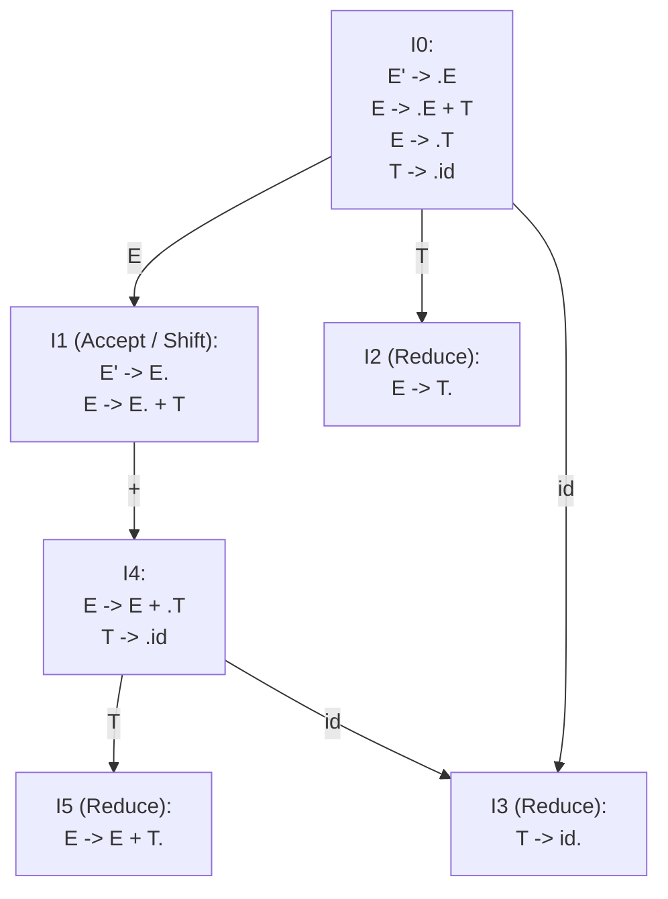

# LR(0) Items and the LR(0) Automaton

## Starting Point and the Problem

In [[Shift-Reduce Parsing and Parsing Conflicts]], we established that a shift-reduce parser must decide when to **shift** and when to **reduce**. How can the parser know whether the symbols currently sitting on the stack form a valid prefix of some legal right-sentential form?

A naive approach would require the parser to scan the entire stack history from bottom to top on every token, an $O(n^2)$ operation. Donald Knuth proved in 1965 that the set of all **viable prefixes** (prefixes of right-sentential forms that can appear on the stack of a shift-reduce parser) forms a **Regular Language**! 

Because viable prefixes form a regular language, they can be recognized by a **Deterministic Finite Automaton (DFA)**. This automaton is the **LR(0) Automaton**, and its states are sets of **LR(0) Items**.

---

## Developing the Core Idea: What is an LR(0) Item?

### Formal Definition
An **LR(0) Item** of a grammar $G$ is a production rule with a special marker—a **dot ($\cdot$)**—placed at some position in the body of the production:
$$A \to \alpha \cdot \beta$$
where $A \to \alpha \beta$ is a production in $G$.

For an $\epsilon$-production $A \to \epsilon$, there is only one item: $A \to \cdot$.

### The Intuitive Meaning of the Dot
The dot ($\cdot$) divides the production into two distinct conceptual zones:
1. **To the left of the dot ($\alpha$):** Symbols that have **already been seen** and shifted onto the parser stack.
2. **To the right of the dot ($\beta$):** Symbols that we **expect to see** in the future from the remaining input stream.

```
                  Already on stack           Expected from input
                         |                            |
                         v                            v
                  A  ->  alpha           .            beta
```

#### The Four Item Categories
For a production like $A \to X Y Z$:
1. $A \to \cdot X Y Z$: We hope to see a string derivable from $X Y Z$ next. Zero symbols matched yet.
2. $A \to X \cdot Y Z$: We have already seen $X$ on the stack; we expect $Y Z$ next.
3. $A \to X Y \cdot Z$: We have already seen $X Y$ on the stack; we expect $Z$ next.
4. $A \to X Y Z \cdot$: Complete Item (Reduce Item)! We have seen the entire body $X Y Z$ on the stack. The body is a candidate handle ready to be reduced to $A$!

---

## The Augmented Grammar

To define when parsing is complete and unambiguously accept the input, the grammar is **augmented** with a new start symbol $S'$ and production:
$$S' \to S$$
where $S$ is the original start symbol.
- When the parser is about to reduce via $S' \to S$, the item is:
  $$S' \to S \cdot$$
- Reaching this item signals that the entire source sentence has been recognized and the input stream is empty. The parser immediately **accepts** and halts.

---

## The Two Foundational Operations on Item Sets

An individual state in the LR(0) automaton is not a single item; it is a **set of LR(0) items** representing all possible rules and positions that could be active simultaneously. 

To construct these states and transitions, we define two formal functions: **$\text{CLOSURE}$** and **$\text{GOTO}$**.

---

### Operation 1: $\text{CLOSURE}(I)$

If $I$ is a set of items for a grammar, the closure of $I$ is constructed by the following algorithm:

```text
Algorithm CLOSURE(I):
1. Initially, add every item in I to CLOSURE(I).
2. If A -> alpha . B beta is in CLOSURE(I), and B is a nonterminal:
   For every production B -> gamma in the grammar:
       Add the item B -> . gamma to CLOSURE(I) (if not already present).
3. Repeat step 2 until no more new items can be added.
```

#### Why Does $\text{CLOSURE}$ Work?
If $A \to \alpha \cdot B \beta$ is in the set, the parser expects to see a string derivable from $B$ next. Because $B$ is a nonterminal, any string derived from $B$ must begin with the right-hand side of some production for $B$ (i.e., $B \to \gamma$). Therefore, the parser must also be prepared to see $B \to \cdot \gamma$!

#### Concrete Example:
Given augmented grammar:
$$E' \to E, \quad E \to E + T \mid T, \quad T \to \mathbf{id}$$
Let $I = \{[E' \to \cdot E]\}$.
1. Start with $E' \to \cdot E$. The dot precedes nonterminal $E$.
2. Add all productions for $E$ with dot at the beginning:
   $$E \to \cdot E + T, \qquad E \to \cdot T$$
3. Now $E \to \cdot T$ has the dot preceding nonterminal $T$.
4. Add all productions for $T$ with dot at the beginning:
   $$T \to \cdot \mathbf{id}$$
5. The dot in $T \to \cdot \mathbf{id}$ precedes a terminal ($\mathbf{id}$), so no further items can be added.
$$\text{CLOSURE}(\{[E' \to \cdot E]\}) = \{[E' \to \cdot E], \; [E \to \cdot E + T], \; [E \to \cdot T], \; [T \to \cdot \mathbf{id}]\}$$

---

### Operation 2: $\text{GOTO}(I, X)$

$\text{GOTO}(I, X)$ defines the state transition of the automaton from item set $I$ upon observing grammar symbol $X$ (where $X$ may be a terminal or a nonterminal).

### Formal Definition
$$\text{GOTO}(I, X) = \text{CLOSURE}(\{ [A \to \alpha X \cdot \beta] \mid [A \to \alpha \cdot X \beta] \in I \})$$

#### Execution Mechanism:
1. Find all items in $I$ where the dot immediately precedes symbol $X$:
   $$[A \to \alpha \cdot X \beta]$$
2. Move the dot past $X$ (representing that $X$ has now been shifted onto the stack):
   $$[A \to \alpha X \cdot \beta]$$
3. Take the $\text{CLOSURE}$ of this newly formed set of items!

---

## Canonical Collection of Sets of LR(0) Items

The canonical collection $\mathcal{C} = \{I_0, I_1, \dots, I_n\}$ forms the complete set of states of the LR(0) automaton.

```text
Algorithm Construct_Canonical_LR0_Collection:
C = { CLOSURE({[S' -> . S]}) }  // State I_0

repeat:
    for each item set I in C:
        for each grammar symbol X in (V union Sigma):
            if GOTO(I, X) is not empty and not in C:
                add GOTO(I, X) to C
until no new item sets are added to C.
```

---

## Kernel versus Non-Kernel Items: The Space Optimization

In large industrial grammars (like C++ or Java), an LR automaton contains thousands of states, and storing every item in every state consumes significant memory. 

Compiler theorists divide LR items into two categories:
1. **Kernel Items:**
   - The initial item: $S' \to \cdot S$.
   - All items whose dot is **NOT at the left end** (i.e., items where at least one symbol has already been shifted: $A \to \alpha \cdot \beta$ with $\alpha \neq \epsilon$).
2. **Non-Kernel Items:**
   - All items whose dot is at the very beginning: $A \to \cdot \gamma$ (except $S' \to \cdot S$).

### The Kernel Invariant and Storage Theorem
- Non-kernel items are generated *purely deterministically* by applying the $\text{CLOSURE}$ operation to kernel items.
- **Space-Saving Theorem:** A parser generator needs to store **only the kernel items** for each state in memory. Any non-kernel items can be regenerated on the fly via $\text{CLOSURE}$ whenever needed.
- This optimization reduces the memory footprint of parser generators by over 70%!

---

## Visualizing the LR(0) Automaton

The LR(0) automaton is a standard Deterministic Finite Automaton (DFA) where:
- Each state is an item set $I_i$.
- Transitions on terminals ($a \in \Sigma$) represent **Shift** actions.
- Transitions on nonterminals ($A \in V$) represent **Goto** transitions after a reduction.
- States containing complete items $[A \to \gamma \cdot]$ represent **Reduce** states.



---

## Important Properties and Guarantees

- **Viable Prefix Invariant:** A state in the LR(0) automaton is reachable from the start state $I_0$ along a path labeled $\gamma$ if and only if $\gamma$ is a **viable prefix** of the grammar.
- **Finite State Guarantee:** Because a Context-Free Grammar has a finite number of productions, and each production has a finite number of dot positions, the total number of distinct LR(0) items is strictly finite. Therefore, the canonical collection $\mathcal{C}$ is guaranteed to be finite.

---

## Common Mistakes

- **Forgetting to Take the Closure in GOTO:** Moving the dot past $X$ to get $[A \to \alpha X \cdot B \beta]$ but forgetting to take the $\text{CLOSURE}$ when $B$ is a nonterminal. If the dot lands before a nonterminal, its productions *must* be added to the state!
- **Omitting the Augmented Grammar:** Building item sets without adding $S' \to S$. Without the augmented grammar, the parser has no clean accepting state to differentiate between "reducing $S$" and "accepting the whole program".

---

## Exam Relevance

In BUET CSE 309 examinations:
1. Constructing the complete canonical collection of LR(0) item sets for a given grammar.
2. Formally executing $\text{CLOSURE}(I)$ and $\text{GOTO}(I, X)$ operations with full derivation steps.
3. Distinguishing between kernel and non-kernel items.

---

## Related Concepts

- [[Bottom-Up Parsing, Reductions, and Handles]]
- [[Shift-Reduce Parsing and Parsing Conflicts]]
- [[SLR(1) Parsing Table Construction and LR Parser Algorithm]]
- [[SLR(1) Automaton and Parsing Table Construction Example]]

---

## Prerequisites

- [[Bottom-Up Parsing, Reductions, and Handles]]
- [[Shift-Reduce Parsing and Parsing Conflicts]]

---

## Problems

- [[Problem — SLR(1) Table Construction and Conflict Analysis]]

---

## Sources

- **Lecture Slides:** [[cse309/01 - Sources/Lectures/Rumi Sir Merged.pdf|Rumi Sir Merged.pdf]], Chapter 4: Syntax Analysis (Slides 567–646).
- **Textbook:** Aho, Lam, Sethi, Ullman, *Compilers: Principles, Techniques, & Tools* (2nd Ed.), Section 4.5.1–4.5.2 (pp. 238–246).

---

## Navigation

> 📖 **Reading Order:** Step 18 of 76 | **Module 4: Bottom-Up Parsing & LR Parsers**  
> ◄ **Previous:** [[Shift-Reduce Parsing and Parsing Conflicts]] | ► **Next:** [[SLR(1) Parsing Table Construction and LR Parser Algorithm]]
