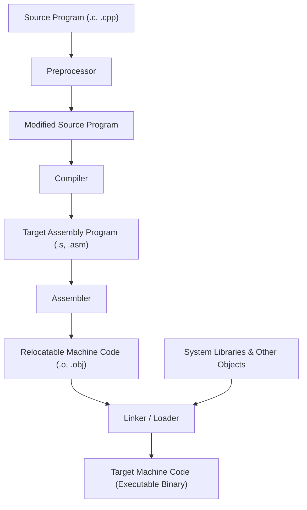
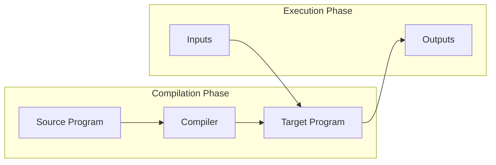
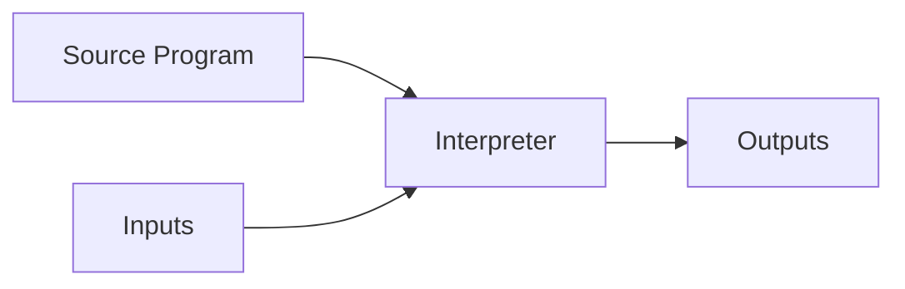

# Language Processing System and Translators

## Starting Point and the Problem

Computers operate exclusively on low-level binary instructions ($0$s and $1$s) encoded for specific microarchitectures. Conversely, software engineering requires high-level, human-readable programming languages offering abstractions like loops, object orientation, type safety, and memory management. 

To bridge this fundamental gap, computer systems require automated **translators**—programs that take source code written in one language and translate it into an equivalent target program in another language. However, turning a source text file into an executing process in memory is rarely done by a single monolithic tool. A high-level language program undergoes a pipeline of coordinated software tools known as the **Language Processing System**.

---

## Developing the Core Idea: The Language Processing Pipeline

Consider writing a program in C/C++. The raw text written by a programmer is not immediately handed to a machine code generator. The program progresses through distinct stages:

Each tool in this pipeline addresses a specific layer of abstraction:
1. **Preprocessor:** Handles text-level transformations before language parsing begins (e.g., macro expansion, file inclusion, conditional compilation).
2. **Compiler:** Performs the complex analysis of programming language semantics, translating high-level constructs into equivalent assembly code.
3. **Assembler:** Translates symbolic assembly mnemonics into relocatable machine instructions and bit patterns.
4. **Linker & Loader:** Resolves cross-file references, incorporates library routines, and places code into physical memory addresses for execution.

---

## Compilers versus Interpreters

Language processors fall into two classic execution models: **Compilation** and **Interpretation**.

### 1. The Pure Compiler
A **compiler** is a program that reads a program in one language (the source language) and translates it into an equivalent program in another language (the target language, typically assembly or machine code).
- **Execution Model:** Translation is decoupled from execution. The compiler translates the source program once. The resulting executable is run independently on the target machine with user inputs.
- **Advantages:** Superior runtime execution speed, intensive ahead-of-time (AOT) optimizations, early compile-time static error detection.

### 2. The Pure Interpreter
An **interpreter** does not generate an explicit machine-language target program. Instead, it reads the source program statement-by-statement and immediately executes the operations directly using the user's input.
- **Advantages:** Rapid development loop (no separate compilation step), superior interactive debugging, dynamic type flexibility.
- **Disadvantages:** Slower runtime execution (often 10x to 100x slower) because language syntax and constructs are re-analyzed repeatedly during loops.

### 3. Hybrid Implementations and Just-In-Time (JIT) Compilation
Modern runtime environments (such as Java JVM and .NET CLR) combine compilation and interpretation to achieve both portability and high execution performance:
1. **Source to Bytecode:** A compiler (e.g., `javac`) translates high-level source code into an intermediate, architecture-neutral bytecode representation (`.class` files).
2. **Virtual Machine Interpretation:** The Java Virtual Machine (JVM) interprets the bytecode, allowing identical binary files to run across diverse hardware architectures ("Write Once, Run Anywhere").
3. **Just-In-Time (JIT) Compilation:** To eliminate the speed penalty of pure interpretation, modern JVMs (such as HotSpot or JRockit) monitor running code. Frequently executed loops and methods ("hot spots") are dynamically compiled into native machine code directly at runtime. Subsequent invocations execute native CPU instructions at full silicon speed.

---

## Components of the Language Processing System

### 1. The Preprocessor
Before syntactic analysis begins, the preprocessor transforms the raw source stream:
- **Macro Definition and Expansion:** Replaces symbolic macros (e.g., `#define PI 3.14159` or parameterized macros `#define RADTODEG(x) ((x) * 57.29578)`) with raw replacement text.
- **File Inclusion:** Copies entire header files directly into the source text (e.g., `#include <stdio.h>`).
- **Rational Preprocessing / Language Extensions:** Augments older or simpler languages with advanced control flow structures (e.g., macro preprocessors converting Ratfor into Fortran).
- **Conditional Compilation:** Filters out code blocks based on preprocessor conditions (e.g., `#ifdef DEBUG ... #endif`).

### 2. The Assembler
Compilers frequently emit assembly language rather than raw binary because assembly is easier to produce, debug, and inspect. The **assembler** translates mnemonic assembly instructions (such as `MOV`, `ADD`, `JMP`) into binary machine language.
- The output of the assembler is **Relocatable Machine Code** (object files like `.o` or `.obj`).
- "Relocatable" means memory addresses are not fixed; the code assumes a base address of zero and contains relocation tables indicating which bytes must be modified when placed into actual memory.

### 3. Linker versus Loader

The distinction between linking and loading is a central systems concept:

| Feature | Linker (`ld`) | Loader |
|---|---|---|
| **Primary Task** | Resolves external references and merges multiple object files into a single executable. | Allocates memory and loads executable instructions/data into physical RAM. |
| **Input** | Relocatable object files (`.o`, `.obj`) and library archives (`.a`, `.lib`, `.so`, `.dll`). | Executable binary program stored on disk. |
| **Output** | A single integrated executable file on disk. | An active running process in primary memory. |
| **Address Binding** | Resolves internal relative offsets between separate translation units. | Relocates addresses to absolute memory coordinates and initializes stack/heap registers. |

#### Static versus Dynamic Linking
- **Static Linking:** The linker copies all external library code (e.g., standard C library functions) directly into the final executable file at compile time. The executable is self-contained but large, and library updates require relinking.
- **Dynamic Linking:** The linker only records external symbol stubs. At load time or runtime, shared libraries (`.so` in Linux, `.dll` in Windows) are mapped into memory and shared across multiple running processes, saving disk space and physical RAM.

---

## Important Properties and Guarantees

- **Equivalence Preservation:** A translator must preserve the operational semantics of the source program. For all valid inputs, the target program must produce the exact observable behavior and outputs specified by the source language standard.
- **Independence of Stages:** By decoupling preprocessing, compilation, assembling, and linking, compiler suites can reuse assemblers and linkers across multiple programming language front ends.

---

## Common Mistakes

- **Confusing Preprocessor Macros with Compiler Functions:** Thinking `#define SQUARE(x) x * x` behaves like a function. If called with `SQUARE(2 + 3)`, textual substitution yields `2 + 3 * 2 + 3 = 11` rather than $(2+3)^2 = 25$.
- **Confusing Compilers with Interpreters:** Assuming an interpreter generates a hidden `.exe` file on disk. Interpreters execute code directly in memory without emitting standalone machine code.
- **Assuming the Compiler Directly Generates Running Memory Images:** Overlooking that object files must still pass through linking (to resolve library references) and loading (to bind to virtual memory addresses) before execution.

---

## Exam Relevance

In BUET CSE 309, language processing fundamentals appear in:
1. Short-answer and conceptual questions comparing Compilers vs Interpreters and static vs dynamic linking.
2. Explaining the complete step-by-step toolchain from C source code to running binary.
3. Describing the hybrid compilation and JIT execution model of the Java Virtual Machine.

---

## Related Concepts

- [[Structure and Phases of a Compiler]]
- [[Lexical Analysis Fundamentals]]
- [[Run-Time Storage Organization and Activation Records]]

---

## Prerequisites

- High-level programming language literacy (C/C++ and Java)
- Basic operating system execution concepts (processes, object files, memory layout)

---

## Problems

- [[Problem — Lexical Token Recognition and Buffer Simulation]]

---

## Sources

- **Lecture Slides:** [[cse309/01 - Sources/Lectures/Rumi Sir Merged.pdf|Rumi Sir Merged.pdf]], Chapter 1: Introduction and Basic Concepts (Slides 10–67, 100–128).
- **Textbook:** Aho, Lam, Sethi, Ullman, *Compilers: Principles, Techniques, & Tools* (2nd Ed.), Section 1.1–1.2 (pp. 1–12).

---

## Navigation

> 📖 **Reading Order:** Step 01 of 76 | **Module 1: Compiler Architecture & Language Processors**  
> ◄ **Previous:** *Start of Course* | ► **Next:** [[Structure and Phases of a Compiler]]
