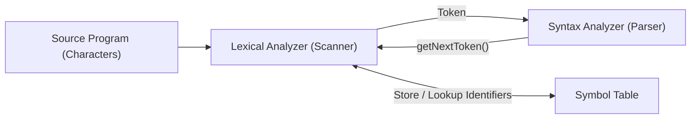

# Lexical Analysis Fundamentals

## Starting Point and the Problem

A source program written by a software engineer enters the compiler as a flat, unformatted sequence of ASCII or UTF-8 characters:
```text
f l o a t <space> r a t e <space> = <space> 0 . 0 5 ; \n
```
The subsequent compiler phase, the **Syntax Analyzer (Parser)**, operates on abstract grammatical units (like identifiers, operators, numbers, and statement terminators). Feeding raw individual characters directly into a Context-Free Grammar parser would exponentially blow up the size of the grammar rules, force the grammar to specify low-level character patterns (like whitespace, comments, and digit sequences), and cripple compiler parsing performance.

To prevent this complexity, the compiler delegates character-level processing to a dedicated first phase: the **Lexical Analyzer (Scanner)**.

---

## Developing the Core Idea: The Lexical Architecture

The lexical analyzer sits between the source code file and the syntax analyzer:



In modern compilers, the scanner does not read the entire file and dump all tokens into a giant file on disk. Instead, it operates as a **subroutine** to the parser:
1. The parser calls `getNextToken()`.
2. The scanner reads characters from its input buffer until it identifies the next valid word.
3. The scanner returns a single token object to the parser.
4. The scanner strips out blank spaces, tabs, newlines, and comments, insulating the parser from surface-level formatting variations.
5. The scanner tracks line numbers and character offsets to provide accurate error messages when syntax or semantic errors occur later.

---

## Why Separate Lexical Analysis from Syntax Analysis?

Separating scanning from parsing is one of the oldest and most successful architectural divisions in computer science. It provides three major advantages:
1. **Simplicity of Design:** Stripping whitespace, stripping comments, and recognizing simple token formats (like variable names and integers) is mathematically much simpler than parsing nested expressions and control flow. Removing this burden from the parser keeps the grammar clean and manageable.
2. **Compiler Efficiency:** Lexical analysis spends the vast majority of time reading individual characters from disk or memory buffers. Using specialized, high-performance buffer techniques (such as double buffering with sentinels) and finite automata allows the scanner to run at memory bus speeds, optimizing the most character-intensive phase of compilation.
3. **Compiler Portability:** Device-specific character encodings, newline conventions (`\r\n` vs `\n`), and input stream quirks are isolated strictly within the lexical analyzer. The parser remains 100% portable across platforms.

---

## The Foundational Triad: Tokens, Patterns, and Lexemes

Understanding lexical analysis requires strictly distinguishing between three related terms:

| Term | Formal Definition | Informally | Concrete Examples |
|---|---|---|---|
| **Token** | An abstract category / terminal symbol used by the parser. | The *class* or *tag*. | `id`, `number`, `if`, `else`, `relop`, `assign_op` |
| **Pattern** | A formal description (rule) of the set of strings that can form a token. | The *blueprint* or *regex*. | `[a-zA-Z_][a-zA-Z0-9_]*` for identifiers; `[0-9]+` for digits |
| **Lexeme** | A concrete sequence of characters in the source text that matches the pattern for a token. | The *actual text instance*. | `position`, `counter`, `3.14159`, `==`, `<=` |

### Visual Representation
Consider the C code statement:
```c
total = sum + 42;
```
The scanner extracts four tokens:
1. Characters `total` match the pattern for an identifier $\implies$ Lexeme: `"total"`, Token: `id`.
2. Character `=` matches the pattern for assignment $\implies$ Lexeme: `"="`, Token: `assign_op`.
3. Characters `sum` match the pattern for an identifier $\implies$ Lexeme: `"sum"`, Token: `id`.
4. Character `+` matches the pattern for addition $\implies$ Lexeme: `"+"`, Token: `add_op`.
5. Characters `42` match the pattern for a number $\implies$ Lexeme: `"42"`, Token: `number`.
6. Character `;` matches the pattern for statement end $\implies$ Lexeme: `";"`, Token: `;`.

---

## Attributes of Tokens

A parser only needs the abstract token name (e.g., `id`) to verify grammatical structure. However, subsequent phases (semantic analysis, code generation) must know *which* identifier was used and *what* numeric value was parsed!

Therefore, the scanner returns a 2-tuple:
$$\langle \text{TokenName}, \text{AttributeValue} \rangle$$
- **Simple Tokens:** For operators and keywords (like `+`, `;`, `if`), the token name alone specifies the semantics. The attribute value is null.
- **Identifiers:** When the scanner encounters an identifier, it enters the lexeme into the Symbol Table (or retrieves its existing record) and returns the pointer to that symbol table entry as the attribute:
  $$\langle \mathbf{id}, \text{ptr to symbol table entry for "count"} \rangle$$
- **Constants / Literals:** For numbers and string literals, the attribute value holds the literal value or a pointer to a constant table entry:
  $$\langle \mathbf{number}, 42 \rangle \quad \text{or} \quad \langle \mathbf{string\_literal}, \text{ptr to "Hello\n"} \rangle$$

---

## Lexical Errors and Error Recovery Strategies

A lexical error occurs when the scanner cannot find any valid pattern that matches the prefix of the remaining input.
- **Example:** In a language where identifiers cannot contain `@`, encountering `@count` or a stray character like `#` outside preprocessor context.

Because stopping compilation immediately on the very first illegal character is frustrating to programmers, compilers implement **Lexical Error Recovery Strategies**:

1. **Panic Mode (Character Skipping):**
   - The scanner deletes successive characters from the input stream until it encounters a valid character that can begin a legal token (e.g., whitespace, punctuation, or a letter).
   - This is the most common and robust recovery technique in production scanners.
2. **Deleting Extraneous Characters:**
   - If a word contains an illegal character embedded inside (e.g., `tot@l`), deleting the single character `@` allows the remainder to form a valid identifier.
3. **Inserting a Missing Character:**
   - Useful for common typos where an essential delimiter is omitted.
4. **Replacing an Incorrect Character:**
   - Replacing a character with a legal adjacent character (e.g., replacing `&` with `&&` or vice versa).
5. **Transposing Adjacent Characters:**
   - Correcting common programmer typing inversions (e.g., transforming `teh` into `the`, or `>=` typed as `=>`).

---

## Important Properties and Guarantees

- **Regularity:** Tokens are almost universally specified using **Regular Languages** (Regular Expressions). Regular languages can be recognized in linear time $O(n)$ with $O(1)$ memory using **Deterministic Finite Automata (DFA)**.
- **Determinism:** At every character step, a correctly constructed lexical analyzer makes a deterministic choice, consuming each source character in strictly $O(1)$ constant time.

---

## Common Mistakes

- **Confusing Tokens and Lexemes:** Saying "variable $x$ is a token." $x$ is a *lexeme*; `id` is the *token*.
- **Assuming the Scanner Knows Types:** Believing the scanner knows whether an identifier is an `int` or a `float`. The scanner only knows that `x` is an identifier; determining its type requires symbol table declaration lookup in the Semantic Analyzer!
- **Overcomplicating the Scanner:** Trying to handle balanced brackets `( ( ) )` in the lexical analyzer. Regular expressions cannot match arbitrary nested structures (which requires a pushdown automaton / context-free grammar).

---

## Exam Relevance

In BUET CSE 309 examinations:
1. Distinguishing between Tokens, Patterns, and Lexemes with concrete code examples.
2. Tracing the sequence of token-attribute pairs emitted for a given C statement.
3. Explaining lexical error recovery strategies (specifically panic mode deletion).

---

## Related Concepts

- [[Structure and Phases of a Compiler]]
- [[Input Buffering and Sentinel Techniques]]
- [[Specification and Recognition of Tokens]]
- [[Lexical Analyzer Generation with Lex]]

---

## Prerequisites

- [[Structure and Phases of a Compiler]]

---

## Problems

- [[Problem — Lexical Token Recognition and Buffer Simulation]]

---

## Sources

- **Lecture Slides:** [[cse309/01 - Sources/Lectures/Rumi Sir Merged.pdf|Rumi Sir Merged.pdf]], Chapter 3: Lexical Analysis (Slides 129–165).
- **Textbook:** Aho, Lam, Sethi, Ullman, *Compilers: Principles, Techniques, & Tools* (2nd Ed.), Section 3.1 (pp. 109–115).

---

## Navigation

> 📖 **Reading Order:** Step 03 of 76 | **Module 2: Lexical Analysis**  
> ◄ **Previous:** [[Structure and Phases of a Compiler]] | ► **Next:** [[Input Buffering and Sentinel Techniques]]
