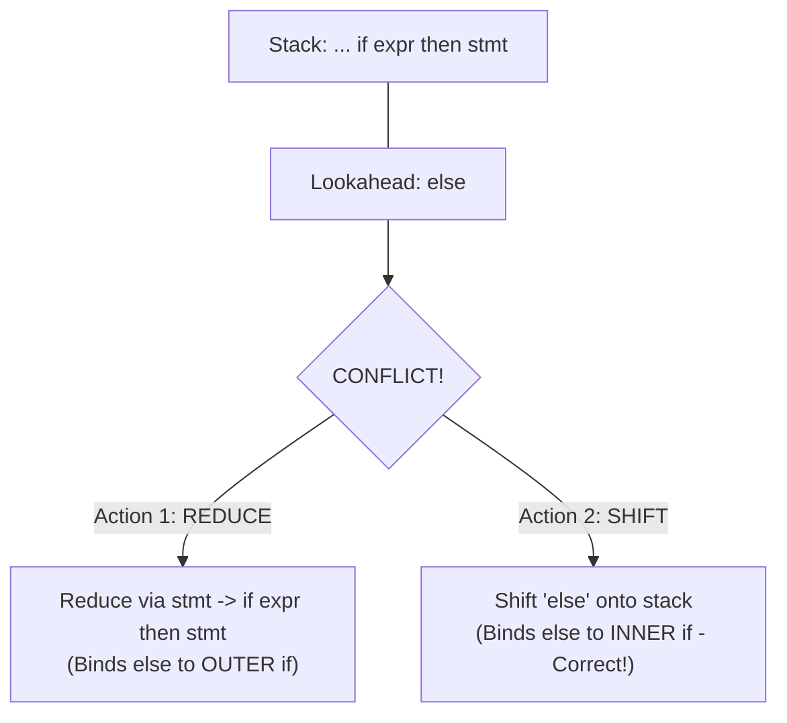

# Shift-Reduce Parsing and Parsing Conflicts

## Starting Point and the Problem

In [[Bottom-Up Parsing, Reductions, and Handles]], we established that bottom-up parsing reconstructs a rightmost derivation in reverse by repeatedly locating the **handle** on top of the stack and reducing it. 

To execute this mechanism in software, compilers use the **Shift-Reduce Parsing Architecture**. However, building a shift-reduce parser is not as simple as checking whether the top of the stack matches some production body. In many grammar configurations, the parser reaches a state where the available grammar rules and lookahead tokens suggest multiple contradictory actions. These dilemmas are called **Shift-Reduce Parsing Conflicts**, and resolving them is the central design problem of bottom-up parser construction.

---

## The Shift-Reduce Parsing Engine

A shift-reduce parser uses two primary data structures:
1. **The Stack:** Holds grammar symbols (and parser states). Initialized with the bottom marker `$`.
2. **The Input Buffer:** Holds the unread terminal tokens, followed by the endmarker `$`.

```
+---------------------+             +--------------------+
| STACK: $  X1  X2... |             | INPUT: a1 a2 ... $ |
+---------------------+             +--------------------+
          |                                   |
          v                                   v
    [ Top of Stack ]                 [ Lookahead Token ]
          |                                   |
          +-----------------+-----------------+
                            |
                            v
            +-------------------------------+
            |  Shift-Reduce Parsing Engine  |
            +-------------------------------+
                            |
           +----------------+----------------+
           |                |                |
           v                v                v
       (Shift)          (Reduce)          (Accept)
```

---

## The Four Fundamental Actions

At each step, the parser examines the symbols on top of the stack and the current lookahead token in the input buffer, choosing exactly one of four actions:

### 1. Shift
- **Operation:** Read the current lookahead terminal from the input buffer, push it onto the top of the stack, and advance the input pointer to the next token.
- **When Chosen:** When the symbols on top of the stack do not yet form a complete handle, but could become part of a handle if more input is read.

### 2. Reduce
- **Operation:** The handle $\beta$ is currently on top of the stack. The parser pops $|\beta|$ symbols from the stack and pushes the nonterminal head $A$ (where $A \to \beta$ is the handle production).
- **When Chosen:** When the parser identifies that the symbols on top of the stack form a complete handle.

### 3. Accept
- **Operation:** Parsing successfully terminates!
- **When Chosen:** When the stack contains only the start symbol $S$ (and `$`), and the input buffer contains only the endmarker `$`.

### 4. Error
- **Operation:** The parser calls a syntax error recovery routine.
- **When Chosen:** When the parser reaches a configuration from which no legal continuation is grammatically possible.

---

## Shift-Reduce Parsing Conflicts

A conflict occurs when a shift-reduce parser, examining the stack and lookahead token, cannot make a unique deterministic decision. There are two primary categories of conflicts:

### 1. Shift/Reduce Conflict
A **Shift/Reduce Conflict** occurs when the parser cannot decide whether to:
- **Shift** the current input terminal onto the stack (building a longer potential handle), OR
- **Reduce** the symbols currently on top of the stack via some production $A \to \beta$.

#### Canonical Example: The Dangling-Else Problem
Consider the standard ambiguous conditional grammar:
$$\begin{aligned}
\text{stmt} &\to \mathbf{if} \; \text{expr} \; \mathbf{then} \; \text{stmt} \\
&\;\mid \mathbf{if} \; \text{expr} \; \mathbf{then} \; \text{stmt} \; \mathbf{else} \; \text{stmt} \\
&\;\mid \text{other}
\end{aligned}$$
Suppose the parser has shifted tokens and is in the following configuration:
- **Stack:** `... if expr then stmt`
- **Input:** `else ... $`

The parser faces an irresolvable conflict:
- **Reduce Option:** The stack contains `if expr then stmt`, which is the complete body of production $\text{stmt} \to \mathbf{if} \; \text{expr} \; \mathbf{then} \; \text{stmt}$. The parser could reduce the stack to $\text{stmt}$! (This would associate the `else` with an outer `if`).
- **Shift Option:** The stack prefix `if expr then stmt` followed by `else` matches the beginning of the longer production $\text{stmt} \to \mathbf{if} \; \text{expr} \; \mathbf{then} \; \text{stmt} \; \mathbf{else} \; \text{stmt}$. The parser could **shift** `else`! (This would associate the `else` with the inner `if`).



#### Resolution in Parser Generators (Yacc / Bison)
Parser generators resolve shift/reduce conflicts using explicit rules:
- **Default Disambiguation Rule:** *In a shift/reduce conflict, always favor SHIFT over REDUCE.*
- Shifting `else` naturally associates the `else` with the innermost, most recent `if`, precisely matching standard programming language semantics!

---

### 2. Reduce/Reduce Conflict
A **Reduce/Reduce Conflict** occurs when the top of the stack matches the right-hand side of **two or more distinct productions**, and the parser cannot determine which nonterminal to reduce to.

#### Canonical Example: Procedure Calls versus Array Subscripts
Consider a language where both function calls and array references use parentheses:
- Function call: `p(i, j)`
- Array access: `A[i, j]` written as `A(i, j)` in Fortran/Ada.

Suppose the grammar has:
$$\begin{aligned}
\text{call} &\to \mathbf{id} \; ( \; \text{actual\_params} \; ) \\
\text{array\_ref} &\to \mathbf{id} \; ( \; \text{subscripts} \; ) \\
\text{actual\_params} &\to \text{actual\_params} , \text{expr} \mid \text{expr} \\
\text{subscripts} &\to \text{subscripts} , \text{expr} \mid \text{expr}
\end{aligned}$$

When the parser sees:
- **Stack:** `... id ( expr`
- **Input:** `, ...`

Both $\text{actual\_params} \to \text{expr}$ and $\text{subscripts} \to \text{expr}$ have $\text{expr}$ as their body!
- Does the parser reduce $\text{expr}$ to $\text{actual\_params}$?
- Or does it reduce $\text{expr}$ to $\text{subscripts}$?

The parser cannot know whether $\mathbf{id}$ was declared as a procedure or an array by looking only at syntax! This is a **fatal Reduce/Reduce Conflict**.

#### Remedying Reduce/Reduce Conflicts
Reduce/reduce conflicts usually indicate a severe architectural flaw in grammar design. They can be resolved by:
1. **Grammar Unification:** Merging the two concepts at the syntax level into a single nonterminal ($\text{expr\_list}$), deferring the distinction to the Semantic Analyzer where symbol table types are available.
2. **Lexical Disambiguation:** Having the lexical analyzer consult the symbol table and emit distinct tokens (e.g., `proc_id` vs `array_id`).

---

## Important Properties and Guarantees

- **Ambiguous Grammars Always Generate Conflicts:** An ambiguous grammar can **never be LR**. It will *always* generate at least one shift/reduce conflict or reduce/reduce conflict in any LR parsing table.
- **Non-Ambiguity Does Not Guarantee Zero Conflicts:** While all ambiguous grammars have conflicts, some *unambiguous* grammars also have conflicts if the parser's lookahead mechanism is too weak (e.g., an unambiguous grammar that is not SLR(1)).

---

## Common Mistakes

- **Assuming Reduce/Reduce Conflicts Can Be Solved by Precedence:** Precedence declarations (`%left`, `%right`) can easily resolve shift/reduce conflicts (like operator binding), but they *cannot* cleanly resolve reduce/reduce conflicts. Reduce/reduce conflicts almost always require modifying the grammar rules.
- **Forgetting Default Shift Preference:** Assuming Yacc/Bison crashes on dangling else. Yacc reports a warning ("1 shift/reduce conflict") and resolves it in favor of shift, which happens to be the correct semantic behavior.

---

## Exam Relevance

In BUET CSE 309 examinations:
1. Explaining the four shift-reduce actions with concrete stack transitions.
2. Formally describing and diagramming Shift/Reduce conflicts (using the dangling else problem) and Reduce/Reduce conflicts (using parameter vs array lists).
3. Stating the default conflict resolution rules used by parser generators.

---

## Related Concepts

- [[Bottom-Up Parsing, Reductions, and Handles]]
- [[LR(0) Items and the LR(0) Automaton]]
- [[SLR(1) Parsing Table Construction and LR Parser Algorithm]]
- [[Problem — SLR(1) Table Construction and Conflict Analysis]]

---

## Prerequisites

- [[Bottom-Up Parsing, Reductions, and Handles]]

---

## Problems

- [[Problem — SLR(1) Table Construction and Conflict Analysis]]

---

## Sources

- **Lecture Slides:** [[cse309/01 - Sources/Lectures/Rumi Sir Merged.pdf|Rumi Sir Merged.pdf]], Chapter 4: Syntax Analysis (Slides 519–566).
- **Textbook:** Aho, Lam, Sethi, Ullman, *Compilers: Principles, Techniques, & Tools* (2nd Ed.), Section 4.5.3–4.5.4 (pp. 238–241).

---

## Navigation

> 📖 **Reading Order:** Step 17 of 76 | **Module 4: Bottom-Up Parsing & LR Parsers**  
> ◄ **Previous:** [[Bottom-Up Parsing, Reductions, and Handles]] | ► **Next:** [[LR(0) Items and the LR(0) Automaton]]
