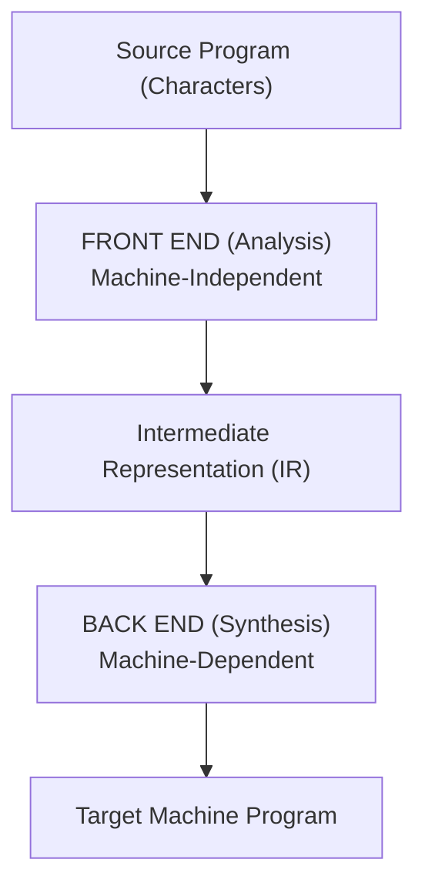
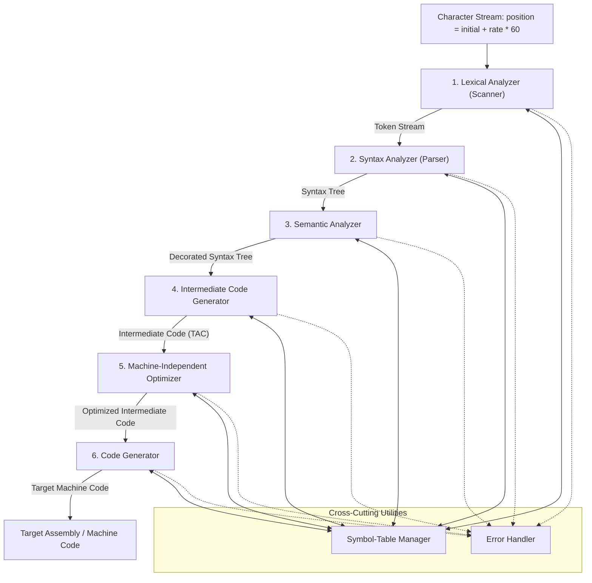

# Structure and Phases of a Compiler

## Starting Point and the Problem

A modern programming language contains rich structural elements: nested loops, arbitrary expression hierarchies, static type systems, user-defined structures, and memory references. Translating this directly into a sequence of binary opcodes in a single monolithic leap is intellectually unmanageable and software-engineering suicide. 

If a compiler were built as a single monolithic block, modifying the target processor (e.g., from x86 to ARM) or supporting a new programming language would require rewriting the entire compiler from scratch. To solve this, all production compilers decompose translation into sequential, specialized **phases**, organized cleanly under a two-part architecture: **Analysis (Front End)** and **Synthesis (Back End)**.

---

## Developing the Core Idea: Analysis versus Synthesis

A compiler operates in two major halves:



1. **Analysis (Front End):** Breaks the source program down into constituent pieces, creates an intermediate grammatical structure, checks that rules of language syntax and static semantics are obeyed, collects identifiers into a **Symbol Table**, and emits a machine-independent **Intermediate Representation (IR)**.
2. **Synthesis (Back End):** Takes the intermediate representation along with the symbol table and constructs the target machine code, performing register allocation, instruction selection, and target-specific optimizations.

### The $M \times N$ versus $M + N$ Architectural Advantage
Why strictly decouple the Front End from the Back End via an Intermediate Representation?
- Suppose we want to support $M$ different programming languages (C, C++, Rust, Swift, Go) across $N$ different computer architectures (x86-64, ARM64, RISC-V, WebAssembly, MIPS).
- Without an IR, building direct monolithic compilers requires $M \times N$ independent compilers.
- With a standardized Intermediate Representation, we only need to build **$M$ Front Ends** (each producing the common IR) and **$N$ Back Ends** (each consuming the common IR). The total engineering effort drops from **$M \times N$** to **$M + N$**!
- This foundational design pattern is the architectural core of modern compiler frameworks such as **LLVM** and **GCC**.

---

## The Six Sequential Phases of a Compiler



### 1. Lexical Analysis (Scanning)
- **Input:** Raw character stream of the source program.
- **Operation:** Groups characters into meaningful sequences called **lexemes**, discarding whitespace and comments. For each lexeme, it outputs a **token** of the form `⟨token-name, attribute-value⟩`.
- **Example:** The string `position = initial + rate * 60` becomes:
  $$\langle\mathbf{id}, 1\rangle \quad \langle=\rangle \quad \langle\mathbf{id}, 2\rangle \quad \langle+\rangle \quad \langle\mathbf{id}, 3\rangle \quad \langle*\rangle \quad \langle\mathbf{number}, 60\rangle$$

### 2. Syntax Analysis (Parsing)
- **Input:** Linear stream of tokens from the scanner.
- **Operation:** Uses the grammatical rules of the language (expressed as a Context-Free Grammar) to construct a hierarchical syntax tree. Interior nodes represent operations, and child nodes represent arguments.
- **Example:**
  ```mermaid
  graph TD
      EQ["="] --> ID1["id, 1 (position)"]
      EQ --> PLUS["+"]
      PLUS --> ID2["id, 2 (initial)"]
      PLUS --> MUL["*"]
      MUL --> ID3["id, 3 (rate)"]
      MUL --> NUM["60"]
  ```

### 3. Semantic Analysis
- **Input:** Syntax tree and symbol table.
- **Operation:** Checks the source program for semantic consistency with language definitions.
- **Core Responsibilities:**
  - **Type Checking:** Ensures operator operands are compatible (e.g., checking that an array index is an integer, not a float).
  - **Type Coercion (Implicit Conversion):** Inserts type conversion nodes when legal (e.g., converting integer constant `60` into floating-point `inttofloat(60)` if `rate` is a float).

### 4. Intermediate Code Generation (ICG)
- **Input:** Verified, decorated syntax tree.
- **Operation:** Produces an explicit, low-level, machine-independent intermediate representation.
- **Canonical Form:** Three-Address Code (TAC), where each instruction has at most one operator and at most three address operands.
- **Example:**
  $$\begin{aligned}
  t_1 &= \text{inttofloat}(60) \\
  t_2 &= \mathbf{id}_3 * t_1 \\
  t_3 &= \mathbf{id}_2 + t_2 \\
  \mathbf{id}_1 &= t_3
  \end{aligned}$$

### 5. Machine-Independent Code Optimization
- **Input:** Raw intermediate code.
- **Operation:** Analyzes and transforms the intermediate code to make target code run faster and consume less memory, without altering program semantics.
- **Techniques:** Constant folding ($t_1 = \text{inttofloat}(60) \implies 60.0$ evaluated at compile time), common subexpression elimination, dead code removal, loop invariant code motion.
- **Optimized Form:**
  $$\begin{aligned}
  t_1 &= \mathbf{id}_3 * 60.0 \\
  \mathbf{id}_1 &= \mathbf{id}_2 + t_1
  \end{aligned}$$

### 6. Code Generation
- **Input:** Optimized intermediate code and symbol table.
- **Operation:** Maps intermediate operations to native machine instructions, assigning variables to physical hardware CPU registers and memory locations.
- **Example Target Assembly (x86/MIPS):**
  ```assembly
  LDF   R2, id3       ; Load float 'rate' into register R2
  MULF  R2, R2, #60.0 ; Multiply R2 by 60.0
  LDF   R1, id2       ; Load float 'initial' into register R1
  ADDF  R1, R1, R2    ; Add R2 into R1
  STF   id1, R1       ; Store result into 'position'
  ```

---

## Cross-Cutting Operations: Symbol Table and Error Handling

Throughout all six phases, two essential services run concurrently:

### 1. Symbol-Table Management
The **Symbol Table** is a high-performance data structure (typically a hash table with scope handling) that records information about program identifiers:
- Type (integer, float, pointer, array dimensions, function signature).
- Scope level and visibility rules.
- Storage attributes (memory address, register offset, activation record offset).
- It is created and populated during lexical and syntax analysis, verified during semantic analysis, and queried continuously during intermediate code generation and target code emission.

### 2. Error Handling
Each phase can encounter errors:
- **Lexical Errors:** Unrecognized character sequences (e.g., `@#$` in C).
- **Syntactic Errors:** Grammatical violations (e.g., missing semicolons, unmatched parentheses `(x + 5`).
- **Semantic Errors:** Type mismatches (e.g., adding a pointer to a struct, calling a non-function).
- The error handler must report errors clearly (with precise line/column coordinates) and recover so compilation can continue to detect subsequent errors without cascading spurious failures.

---

## Modern Perspectives: Compiler Infrastructure and AI

### 1. Compiler-Construction Tools
Modern compilers are rarely written by hand from scratch. Instead, specialized software tools generate compiler components from formal mathematical specifications:
- **Scanner Generators:** (e.g., Lex, Flex) Generate high-speed lexical analyzers from Regular Expressions.
- **Parser Generators:** (e.g., Yacc, Bison, ANTLR) Generate syntax analyzers from Context-Free Grammars.
- **Syntax-Directed Translation Engines:** Traverse parse trees to evaluate semantic actions and emit intermediate representations.
- **Automatic Code Generators:** Generate target instruction selectors and register mappers from machine-description grammars.
- **Data-Flow Analysis Engines:** Construct control flow graphs and automate data-flow equations for machine-independent and machine-dependent optimizations.

### 2. AI in Compiler Design: Scope, Boundaries, and Recent Initiatives
A central question in modern systems research is: **Can AI or Large Language Models (LLMs) replace a state-of-the-art compiler?**
- **The Theoretical Boundary:** Compilers must be **exact, deterministic, and strictly semantics-preserving**. Because LLMs are probabilistic, even a 0.01% hallucination rate is unacceptable for code compilation. LLMs cannot replace traditional deterministic front-end parsers and type checkers.
- **The Optimization Frontier:** Compilers rely on complex, NP-hard heuristic phase ordering (which optimization passes to run and in what order). Here, AI models achieve breakthrough performance by predicting optimal compilation configurations.

#### Four Major Modern AI Compiler Initiatives:
1. **Large Language Models for Compiler Optimization (Cummins et al.):**
   - Trained a 7B-parameter transformer on LLVM assembly and optimization sequences.
   - The model predicts compiler flags, pass ordering, and optimized code size, achieving a **3.0% instruction-count improvement** over standard `-Oz` clang optimizations.
   - Generated code was compilable 91% of the time and perfectly emulated compiler output 70% of the time.
2. **Meta LLM Compiler (Meta AI):**
   - A suite of models (7B and 13B parameters) built upon Code Llama, trained on **546 billion tokens** of LLVM Intermediate Representation (IR) and assembly code.
   - Dedicated tasks include: (a) deep comprehension of LLVM IR, (b) assembly code representation, (c) binary size minimization, and (d) predicting downstream compiler optimization outcomes.
3. **Compiler-Generated Feedback Loops for LLMs:**
   - Instead of trusting LLM outputs blindly, modern architectures couple the LLM with the deterministic compiler:
     $$\text{LLM Proposes Candidate IR} \longrightarrow \text{Compiler Verifies \& Profiles} \longrightarrow \text{Diagnostic Feedback} \longrightarrow \text{LLM Refines}$$
   - The compiler acts as an infallible ground-truth oracle, guaranteeing semantics preservation while the AI explores vast optimization search spaces.
4. **LLM4Decompile (Reverse Engineering):**
   - Decompilation reverses translation: $\text{Machine Code / Assembly} \to \text{High-Level C Source Code}$.
   - Open-source models ranging from 1.3B to 33B parameters trained to reconstruct human-readable, compilable C code from raw x86/ARM binaries, recovering high-level control constructs, variable scopes, and function signatures.

---

## Common Mistakes

- **Confusing Parsing with Semantic Analysis:** Assuming the parser catches type errors. A parser only checks that grammar rules are obeyed (e.g., `int x = "hello" + 5;` is syntactically completely valid as $\text{type } \mathbf{id} = \text{string} + \text{int}$; only the *semantic analyzer* catches the type mismatch!).
- **Assuming Each Phase Must Be a Separate Program Execution:** While historically compilers made multiple disk-based passes due to 1970s memory limits, modern compilers frequently combine scanning, parsing, and semantic analysis into a single unified pass over the code.

---

## Exam Relevance

In BUET CSE 309 examinations:
1. Explaining the inputs, outputs, and exact transformations performed by each of the 6 phases on a sample arithmetic statement.
2. Diagramming and justifying the Front End vs Back End architectural separation.
3. Defining the role of the Symbol Table across different compiler phases.

---

## Related Concepts

- [[Language Processing System and Translators]]
- [[Lexical Analysis Fundamentals]]
- [[Context-Free Grammars and Syntax Analysis]]
- [[Intermediate Representations and Three-Address Code]]

---

## Prerequisites

- [[Language Processing System and Translators]]

---

## Problems

- [[Problem — Lexical Token Recognition and Buffer Simulation]]

---

## Sources

- **Lecture Slides:** [[cse309/01 - Sources/Lectures/Rumi Sir Merged.pdf|Rumi Sir Merged.pdf]], Chapter 1: Basic Concepts & Compiler Structure (Slides 58–128).
- **Textbook:** Aho, Lam, Sethi, Ullman, *Compilers: Principles, Techniques, & Tools* (2nd Ed.), Section 1.2–1.6 (pp. 4–25).

---

## Navigation

> 📖 **Reading Order:** Step 02 of 76 | **Module 1: Compiler Architecture & Language Processors**  
> ◄ **Previous:** [[Language Processing System and Translators]] | ► **Next:** [[Lexical Analysis Fundamentals]]
