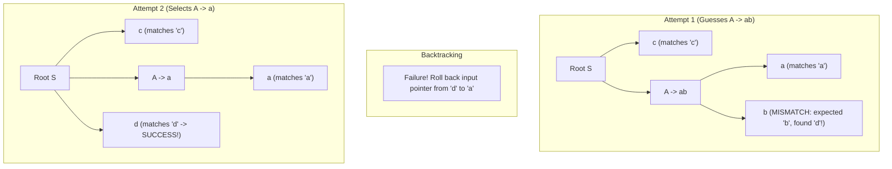

# Top-Down and Predictive Parsing

## Starting Point and the Problem

Top-down parsing attempts to reconstruct a syntax tree by starting at the root (the start symbol $S$) and repeatedly expanding nonterminals until the leaves of the tree match the sequence of terminal tokens provided by the lexical analyzer.

The most intuitive implementation is **Recursive-Descent Parsing**, where each nonterminal in the grammar corresponds to a program function. However, if a nonterminal has multiple production choices ($A \to \alpha \mid \beta$), a naive recursive-descent parser must guess a production. If that guess later fails to match an input token, the parser must backtrack—rolling back the input pointer and undoing state changes. In the worst case, backtracking can cause **exponential time complexity $O(b^n)$**, making it utterly impractical for production compilers.

To eliminate backtracking and guarantee linear $O(n)$ time complexity, compiler designers restrict the grammar to a class known as **LL(1)**, enabling deterministic **Predictive Parsing**.

---

## Developing the Core Idea: From Backtracking to Determinism

Consider grammar:
$$S \to c A d, \qquad A \to a b \mid a$$
Input string: `c a d`



In the naive attempt:
1. The parser expanded $A \to a b$. It matched `a`, but then encountered `d` when expecting `b`.
2. It had to roll back the input pointer back to `a` and try the alternative production $A \to a$.
3. When nested across multiple grammar levels, this trial-and-error search causes combinatorial explosion.

**The Key Insight of Predictive Parsing:**
Can we choose the correct production rule on the *first attempt* without guessing?
Yes—if for every nonterminal $A$, the current lookahead token uniquely identifies at most one valid production! Such parsers are called **Predictive Parsers**.

---

## Programmatic Architecture of Recursive-Descent Predictive Parsers

A recursive-descent parser implements a Context-Free Grammar as a collection of recursive procedures:
1. **One Procedure per Nonterminal:** For every nonterminal $A \in V$, there is a dedicated function `void A()`.
2. **The `match(terminal)` Procedure:** Compares the current lookahead symbol with the expected terminal $t$. If they match, it advances to the next token; otherwise, it raises a syntax error:
   ```c
   void match(terminal t) {
       if (lookahead == t) {
           lookahead = nextTerminal();
       } else {
           reportSyntaxError("Unexpected token");
       }
   }
   ```
3. **Execution Pattern for Productions:**
   If nonterminal $A$ expands to $X_1 X_2 \dots X_k$:
   - For every terminal $X_i$: call `match(X_i)`.
   - For every nonterminal $X_i$: call `X_i()`.

### Concrete Example: Parsing a C `for` Loop
Consider production:
$$\text{stmt} \to \mathbf{for} \; ( \; \text{optexpr} \; ; \; \text{optexpr} \; ; \; \text{optexpr} \; ) \; \text{stmt}$$

The procedure `stmt()` executes code matching the structure of the production body:
```c
void stmt() {
    switch (lookahead) {
        case FOR:
            match(FOR);
            match('(');
            optexpr();
            match(';');
            optexpr();
            match(';');
            optexpr();
            match(')');
            stmt();
            return;
        // other statement cases (if, while, expr, etc.) ...
        default:
            reportSyntaxError("Expected statement");
    }
}
```

### When to Use $\epsilon$-Productions
When should a procedure choose an $\epsilon$-production?
- **Decision Rule:** A procedure for nonterminal $A$ uses an $\epsilon$-production ($A \to \epsilon$) as a default **if the lookahead symbol belongs to $\text{FOLLOW}(A)$** (or when no non-$\epsilon$ production matches).
- **Execution:** In `optexpr()`, if the lookahead symbol is `;` (which is in $\text{FOLLOW}(\text{optexpr})$), the procedure simply returns **without consuming the `;`**, allowing the subsequent `match(';')` in `stmt()` to consume it!

---

## What Does LL(1) Stand For?

Predictive parsers operate on **LL(1)** grammars:
- **First L:** **L**eft-to-right scan of the input stream.
- **Second L:** Produces a **L**eftmost derivation.
- **(1):** Uses **1** token of lookahead at each step to make a parsing decision.

---

## Mathematical Definition and Conditions for an LL(1) Grammar

A Context-Free Grammar $G$ is **LL(1)** if and only if, whenever $A \to \alpha \mid \beta$ are two distinct productions for the same nonterminal $A$, the following three conditions hold:

### Condition 1: Disjoint FIRST Sets
No terminal can belong to both $\text{FIRST}(\alpha)$ and $\text{FIRST}(\beta)$:
$$\text{FIRST}(\alpha) \cap \text{FIRST}(\beta) = \emptyset$$
*Reason:* If a terminal $a$ belonged to both, the parser seeing lookahead $a$ would not know whether to expand $A \to \alpha$ or $A \to \beta$.

### Condition 2: At Most One Can Derive Epsilon
At most one of $\alpha$ or $\beta$ can derive the empty string $\epsilon$:
$$\text{Not both } \alpha \Rightarrow^* \epsilon \text{ and } \beta \Rightarrow^* \epsilon$$
*Reason:* If both could derive $\epsilon$, the parser could not choose which to pick when matching an empty sequence.

### Condition 3: Disjoint FIRST and FOLLOW Sets on Epsilon Derivation
If $\beta \Rightarrow^* \epsilon$, then $\text{FIRST}(\alpha)$ must be completely disjoint from $\text{FOLLOW}(A)$:
$$\text{FIRST}(\alpha) \cap \text{FOLLOW}(A) = \emptyset$$
*Reason:* If $a \in \text{FIRST}(\alpha)$ and also $a \in \text{FOLLOW}(A)$, then upon seeing lookahead $a$, the parser could either expand $A \to \alpha$ (to match $a$) or expand $A \to \beta \Rightarrow \epsilon$ (letting the following symbol match $a$). The parser would face an irresolvable conflict!

---

## Non-LL(1) Grammars and Their Fatal Flaws

Two structural grammar properties automatically disqualify any grammar from being LL(1):

1. **Left Recursion:**
   If $A \to A \alpha \mid \beta$, then $\text{FIRST}(A \alpha)$ contains $\text{FIRST}(\beta)$, which directly violates Condition 1 ($\text{FIRST}(A \alpha) \cap \text{FIRST}(\beta) \neq \emptyset$). Therefore, **no left-recursive grammar can ever be LL(1)**!
2. **Ambiguity:**
   If a grammar is ambiguous, some sentence has two distinct leftmost derivations. An LL(1) parser is strictly deterministic and produces exactly one leftmost derivation. Therefore, **no ambiguous grammar can ever be LL(1)**!

---

## Syntax Error Handling in Top-Down Parsers

A syntax error in an LL(1) parser occurs when:
1. The top of the stack is a terminal symbol $a$, but the current input token is $b \neq a$.
2. The top of the stack is a nonterminal $A$, the current input token is $a$, and the parsing table entry $M[A, a]$ is **empty (blank)**.

### Panic-Mode Error Recovery using Synchronizing Tokens
Rather than aborting compilation, LL(1) parsers implement panic-mode recovery using **synchronizing tokens**:
1. The compiler designer defines a set of **synchronizing tokens** for each nonterminal $A$—naturally chosen as $\text{FOLLOW}(A)$ plus statement delimiters (like `;` and `}`).
2. In the parsing table $M$, entries $M[A, b]$ for $b \in \text{FOLLOW}(A)$ are marked with a special tag: `synch`.
3. **Recovery Algorithm:**
   - When the parser encounters an empty cell $M[A, a]$ (illegal lookahead $a$):
     - If $a$ is NOT in $\text{FOLLOW}(A)$, the parser skips (discards) token $a$ from the input and keeps $A$ on the stack.
     - If $a$ is in $\text{FOLLOW}(A)$ (table cell contains `synch`), the parser **pops nonterminal $A$ from the stack**!
     - By popping $A$, the parser assumes $A$ was completed, allowing compilation to resume with the symbols that follow $A$.

---

## Important Properties and Guarantees

- **Deterministic Linear Time:** An LL(1) parser processes an input of $n$ tokens in strictly $O(n)$ time. At every step, it either consumes a terminal token or expands a nonterminal.
- **Stack Depth Bound:** The maximum stack depth is bounded by the height of the parse tree, which is $O(n)$ in the worst case and $O(\log n)$ for balanced expressions.

---

## Common Mistakes

- **Assuming All Unambiguous Grammars are LL(1):** A grammar can be 100% unambiguous yet fail to be LL(1) (e.g., if it has left recursion or common prefixes). Left-recursion elimination and left-factoring are mandatory prerequisites.
- **Confusing Lookahead in LL(1) with LL(k):** Thinking LL(1) can look ahead 2 tokens. LL(1) can *only* inspect the single current token at `*forward`.

---

## Exam Relevance

In BUET CSE 309 examinations:
1. Stating and proving the three formal conditions for a grammar to be LL(1).
2. Proving why a left-recursive grammar cannot be LL(1).
3. Explaining panic-mode error recovery and the role of `synch` entries.

---

## Related Concepts

- [[Context-Free Grammars and Syntax Analysis]]
- [[Elimination of Left Recursion and Left Factoring Algorithms]]
- [[FIRST and FOLLOW Sets Formulas]]
- [[LL(1) Parsing Table Construction and Execution Algorithm]]

---

## Prerequisites

- [[Context-Free Grammars and Syntax Analysis]]
- [[FIRST and FOLLOW Sets Formulas]]

---

## Problems

- [[Problem — LL(1) Grammar Verification and Parsing Table Construction]]

---

## Sources

- **Lecture Slides:** [[cse309/01 - Sources/Lectures/Rumi Sir Merged.pdf|Rumi Sir Merged.pdf]], Chapter 4: Syntax Analysis (Slides 355–367, 410–415, 471–491).
- **Textbook:** Aho, Lam, Sethi, Ullman, *Compilers: Principles, Techniques, & Tools* (2nd Ed.), Section 4.4 (pp. 217–228).

---

## Navigation

> 📖 **Reading Order:** Step 12 of 76 | **Module 3: Syntax Analysis & Top-Down Parsing**  
> ◄ **Previous:** [[FIRST and FOLLOW Sets Formulas]] | ► **Next:** [[LL(1) Parsing Table Construction and Execution Algorithm]]
