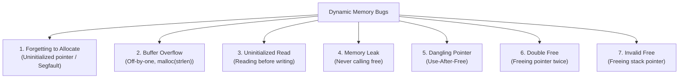

# Memory API and Allocation Safety

## Starting Point and the Problem

In C programs, memory is managed across three regions:
- **Static/Data:** Global variables, allocated at compile time.
- **Automatic/Stack:** Local variables and function frames, allocated and deallocated automatically by compiler-generated stack pointer adjustments (`%esp`/`%rsp`).
- **Dynamic/Heap:** Objects whose lifetimes cannot be determined at compile time or whose sizes depend on runtime input.

Stack memory cannot survive function returns:
```c
int *create_array(void) {
    int arr[100]; // Allocated on the stack
    return arr;   // BUG: Returns pointer to a stack frame that is popped!
}
```
When `create_array` returns, its stack frame is reclaimed. Dereferencing `arr` in the caller accesses undefined or overwritten stack memory. Dynamic memory allocation via the heap is essential for long-lived and variable-sized data structures.

---

## Developing the Idea: The POSIX Memory API

The standard C library provides four core primitives for managing heap memory:

### 1. `malloc(size_t size)`
Allocates an uninitialized contiguous block of `size` bytes on the heap.
```c
int *p = (int *)malloc(10 * sizeof(int));
```
- `sizeof()` is evaluated at **compile time** by the compiler.
- `malloc` returns `void *`, which is implicitly cast to any pointer type in C.
- If the system is out of memory, `malloc()` returns `NULL`. Robust code must always verify `p != NULL`.

### 2. `free(void *ptr)`
Reclaims previously allocated heap memory, returning it to the allocator's free pool.
```c
free(p);
```
- The caller passes only the pointer; the allocator automatically tracks how many bytes to free using hidden metadata stored in an in-band header.
- Passing a pointer not returned by `malloc()`, or passing an interior pointer into an allocated block, causes undefined behavior or immediate crashes.

### 3. `calloc(size_t num, size_t size)`
Allocates contiguous memory for an array of `num` objects, each of size `size`, and **initializes every byte to zero**.
```c
int *p = (int *)calloc(10, sizeof(int)); // All 10 integers set to 0
```

### 4. `realloc(void *ptr, size_t new_size)`
Resizes an existing heap allocation. If sufficient contiguous space exists after the current block, it expands in place; otherwise, it allocates a new block, copies existing data, frees the old block, and returns the new pointer.

---

## How It Works: The Kernel System Calls Behind `malloc`

`malloc()` and `free()` are library functions (`glibc`), not system calls. Executing a system call for every memory allocation would incur catastrophic trap overhead. Instead, `malloc` manages a user-space memory pool (an arena) and requests large blocks of raw virtual memory from the OS kernel using two underlying system calls:

1. **`brk` and `sbrk`:**
   - The heap break pointer marks the current boundary of the process heap.
   - `brk(void *addr)` sets the break pointer to a specific virtual address.
   - `sbrk(intptr_t increment)` increments the break pointer by a given number of bytes and returns the old break address.
2. **`mmap` (Memory Map):**
   - For large allocations (typically $\ge 128\,\text{KB}$), `glibc malloc` bypasses `brk` and uses `mmap(NULL, size, PROT_READ | PROT_WRITE, MAP_ANONYMOUS | MAP_PRIVATE, -1, 0)`.
   - `mmap` requests pages directly from the virtual memory subsystem and can return them to the kernel immediately upon `free()` via `munmap()`.

---

## The Seven Deadly Memory Bugs

Because C does not enforce automated memory safety or garbage collection, dynamic memory is prone to subtle, dangerous bugs:



1. **Forgetting to Allocate Memory:**
   ```c
   char *src = "hello";
   char *dst;
   strcpy(dst, src); // CRASH: dst points to garbage or NULL!
   ```
2. **Buffer Overflow (Not Allocating Enough Space):**
   ```c
   char *src = "hello";
   char *dst = (char *)malloc(strlen(src)); // BUG: forgot +1 for null terminator '\0'
   strcpy(dst, src);                        // Overwrites adjacent heap metadata!
   ```
3. **Uninitialized Read:**
   ```c
   int *arr = (int *)malloc(10 * sizeof(int));
   printf("%d
", arr[3]); // Undefined: contains whatever stale bytes were in RAM
   ```
4. **Memory Leak:**
   Losing all references to allocated memory without calling `free()`. In short-lived CLI utilities, the OS reclaims memory on exit; in long-running daemons (web servers, databases), memory leaks exhaust physical RAM, triggering thrashing or the OS Out-Of-Memory (OOM) killer.
5. **Dangling Pointer (Use-After-Free):**
   ```c
   int *p = malloc(sizeof(int));
   free(p);
   *p = 42; // Catastrophic: memory may have been reassigned to another data structure!
   ```
6. **Double Free:**
   ```c
   free(p);
   free(p); // Corrupts the free list linked structure inside glibc allocator!
   ```
7. **Invalid Free:**
   ```c
   int x = 10;
   free(&x); // CRASH: Passing stack address to heap allocator!
   ```

---

## Technical Details

- **In-Band Allocation Header:** When `malloc(size)` allocates memory, it actually reserves $\text{size} + \text{sizeof(header\_t)}$ bytes. The returned pointer points directly after the header:
  ```
  [ header_t: size = 32, magic = 0x1234 ] [ 32 bytes of user payload ... ]
                                          ^
                                          |-- Returned to caller (ptr)
  ```
  If user code underflows the buffer (writing to `ptr[-1]`), it corrupts the header's magic number or size, leading to unpredictable crashes when `free()` is later invoked.
- **Valgrind and AddressSanitizer (ASan):** Modern developer tools detect these memory bugs at runtime. ASan instruments memory loads and stores with "shadow bytes" to detect out-of-bounds writes and use-after-free conditions immediately.

---

## Important Properties and Why They Hold

- **Spatial Safety Independence:** Dynamic memory allocation APIs are purely user-space runtime conventions; the CPU MMU does not know about `malloc` or `free`. To the MMU, the heap is merely a range of virtual addresses mapped with read/write permissions.
- **Deterministic Lifetime Guarantee:** Heap memory remains valid and allocated until explicitly released by `free()` or until the owning process terminates, allowing complex graphs and recursive data structures to persist across function boundaries.

---

## Common Mistakes

- **Using `sizeof` on a Pointer Variable:**
  ```c
  int *arr = malloc(10 * sizeof(arr)); // WRONG: sizeof(arr) is pointer size (8 bytes on 64-bit), not sizeof(int) (4 bytes)!
  ```
- **Assuming `free()` Clears the Pointer:**
  Calling `free(p)` frees the memory *block*, but variable `p` still holds the physical virtual address. To prevent accidental use-after-free, always set `p = NULL;` immediately after freeing.

---

## Exam Relevance

Frequently tested in exams via:
- Code inspection questions asking students to identify all memory bugs in a given C snippet.
- Distinguishing user-space library functions (`malloc`, `free`) from kernel system calls (`brk`, `sbrk`, `mmap`).
- Explaining the consequences of buffer overflows and heap metadata corruption.

---

## Related Concepts

- [[Address Space Abstraction and Hardware Relocation]]
- [[Free-Space Management and Allocation Policies]]
- [[Process Concepts and Memory Layout]]

---

## Prerequisites

- [[Process Concepts and Memory Layout]]
- [[Address Space Abstraction and Hardware Relocation]]

---

## Problems

- [[Problem — Segmentation Address Translation and Buddy Memory Allocation]]

---

## Sources

- **Lecture Slides:** [[cse313/01 - Sources/Lectures/CSE313_KRV_Merged.pdf|CSE313_KRV_Merged.pdf]], Chapter 14 (Slides 21–42).
- **Textbook:** Arpaci-Dusseau & Arpaci-Dusseau, *Operating Systems: Three Easy Pieces (OSTEP)*, Chapter 14 (Interlude: Memory API).

---

## Navigation

> 📖 **Reading Order:** Step 36 of 68 | **Module 6: Virtual Memory Foundations**  
> ◄ **Previous:** [[Address Space Abstraction and Hardware Relocation]] | ► **Next:** [[Segmentation and External Fragmentation]]
